# CPC Lisp 1.2.1

*A Lisp machine for the Amstrad CPC*

ROMs that start a Lisp instead of BASIC. Common Lisp syntax, lexical closures, macros, a garbage collector
-- in 16 KB of Z80 assembly -- with graphics, sound, files, floats and
editors in four more ROMs, and a bytecode compiler in a fifth.

**It also runs from disc -- and on FutureOS**, TFM's operating system
for the CPC: natively, through FutureOS's own routines (new in 1.0),
started from its desktop on a 464, 664 or 6128 with a 512K expansion,
and back to the desktop with `(reset)` ([*Under
FutureOS*](#under-futureos), below). **Video:**
[CPC Lisp on the 6128 under FutureOS](https://youtu.be/s4BsQOroQUc) (5:08).

**New: the ZX Spectrum.** A 128K Spectrum -- the +2A, +2B or +3, or a
128 -- with a DivMMC runs the same Lisp, the compiler and all, from its
SD card: 40 columns, colour graphics on the Spectrum's attributes, the
AY's three voices, files through esxDOS. It runs on a real +2A
([*On the ZX Spectrum*](#on-the-zx-spectrum), below, with photos;
screenshots [below](#screenshots)). **Video:**
[CPC Lisp on the ZX Spectrum +2](https://youtu.be/4GQVhU6cOpw) (6:02).

**And now the MSX.** An MSX1 -- or any later MSX -- with a memory mapper
and MSX-DOS 2 or Nextor (an MSX SD Mapper & Megaram 512 KB cartridge
brings both) runs it from its SD card: 40 columns, colour graphics in
the VDP's screen 2, the PSG's three voices, floats by the ROM's
Math-Pack, files through DOS. It runs on a real Toshiba HX-10 and a
Philips VG-8020 ([*On the MSX*](#on-the-msx), below, with photos; screenshots
[below](#screenshots)).

**And the Amstrad PCW.** A PCW 8256 or 8512 -- the Schneider Joyce --
boots it from a disc of its own, no CP/M and no ROM: 90 by 32 characters
on its green screen, graphics on its 720 by 256, our own disc routines on
CP/M's file system, our own maths. So far in ZEsarUX and MiSTer's PCW core -- **not yet
tested on a real PCW** ([*On the Amstrad PCW*](#on-the-amstrad-pcw),
below; screenshots [below](#screenshots)).

    CPC Lisp 1.2.1
    A Lisp machine for the Amstrad CPC
    library ROMs 4 5 6 3
    6402 cells free

    LISP> (defun fib (n) (if (< n 2) n (+ (fib (- n 1)) (fib (- n 2)))))
    FIB
    LISP> (fib 17)
    1597
    LISP> (compile 'fib)
    FIB
    LISP> (mapcar #'(lambda (x) (* x x)) '(1 2 3 4 5))
    (1 4 9 16 25)

**Read on:** [the tutorial](docs/tutorial.md) ·
[the reference manual](docs/reference.md) ·
[benchmarks and history](docs/benchmarks.md) ·
[how it is made](docs/design.md). The [Documents](#documents) section
at the end says what is in each.

## Machines

* **The Amstrad CPC** -- 464, 664 and 6128 -- is its home: six ROMs, on
  an expansion ROM board or the LambdaSpeak 4 card (below).
* **From disc, with no ROMs**: a CPC with a 512K RAM expansion --
  Revaldinho's, the DK'tronics, any that banks the DK'tronics way -- runs
  the same six images loaded into it; a plain 6128 runs five, without
  the compiler ([*From disc*](#from-disc), below).
* **On FutureOS**, TFM's operating system, on a 464, 664 or 6128 with
  a 512K expansion: natively, through FutureOS's own routines, from any
  of its drives -- started from its desktop ([*Under
  FutureOS*](#under-futureos), below).
* **The TRS-80 Model I and Model III with
  [X-MEM/80](https://github.com/lambdamikel/x-mem-80)** run it too, as a
  port: the same six images, under LDOS ([*On a
  TRS-80*](#on-a-trs-80), below).
* **The TRS-80 Model 4** with 128 KB runs it natively, under LS-DOS
  6.3.1: 80 by 24 characters and **high-resolution graphics**, 640 by
  240 on the Radio Shack board, the Grafyx Solution or the Improved
  Grafyx -- from a floppy, an HxC or Gotek, or a FreHD ([*The TRS-80
  Model 4*](#the-trs-80-model-4), below).
* **The ZX Spectrum 128K** -- the +2A, +2B and +3, or a 128 -- with a
  **DivMMC** (128 KB of RAM, esxDOS) runs it from an SD card: the same
  six images in the 128K's banks, the machine's own routines in the
  DivMMC's RAM; 40 by 24 characters, graphics in colour, the AY's three
  voices, MIDI out ([*On the ZX Spectrum*](#on-the-zx-spectrum), below).
* **The MSX1** -- or any later MSX -- with a **memory mapper** (144 KB
  free) and **MSX-DOS 2 or Nextor** runs it from DOS: the same six
  images in the mapper's segments; 40 by 24 characters, graphics in
  colour, the PSG's three voices, a RAM disc in the mapper's spare
  segments ([*On the MSX*](#on-the-msx), below).
* **The Amstrad PCW** 8256 or 8512 boots it from its own disc -- a Gotek
  serves one well: the same six images in its 16 KB blocks; 90 by 32
  characters, graphics on its 720 by 256, CP/M's discs through our own
  routines, a RAM disc in the blocks left -- in ZEsarUX and MiSTer's PCW
  core so far, not yet on a real PCW ([*On the Amstrad PCW*](#on-the-amstrad-pcw), below).
* **More Z80 machines are to come**, in this order: the NABU PC, the TA
  alphatronic PC and the Sharp MZ-700.
  Everything a machine provides is behind one interface
  ([`mach/README.md`](mach/README.md)); the CPC's is `mach/cpc/`, the
  TRS-80's `mach/trs80/`, the Model 4's `mach/trs80m4/`, the Spectrum's
  `mach/spectrum/`, the MSX's `mach/msx/`, the PCW's `mach/pcw/`.

## Videos

| | |
|---|---|
|  |  |
| [A Modern Lisp OS for the Amstrad CPC -- Common Lisp in ROM!](https://youtu.be/rrI9Di3qzVM) (11:32) | [CPC Lisp 0.9 Demos -- Turn your Amstrad CPC into a Lisp Machine!](https://youtu.be/qcSBfZ-axFA) (6:51) |
|  |  |
| [CPC LISP running on the CPC 6128 with FutureOS -- Vortex Floppy Emulation with LambdaSpeak AI](https://youtu.be/s4BsQOroQUc) (5:08) | [CPC Lisp on the Sinclair ZX Spectrum +2 -- Common Lisp on the Speccy!](https://youtu.be/4GQVhU6cOpw) (6:02) |

## Screenshots

From the emulators: MAME for the CPC, trs80gp for the TRS-80s, ZEsarUX
for the ZX Spectrum and the PCW, openMSX for the MSX. The same programs,
the same Lisp.

**On the Amstrad CPC**

<table>
<tr><td align="center" valign="top">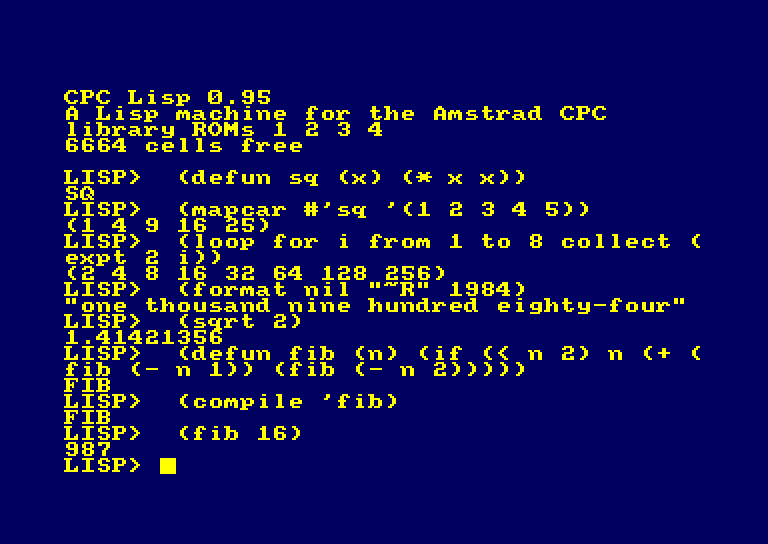defun</code>, <code>mapcar</code>, <code>loop</code>, <code>format</code>, floats, the compiler"> The REPL: <code>defun</code>, <code>mapcar</code>, <code>loop</code>, <code>format</code>, floats, the compiler</td><td align="center" valign="top">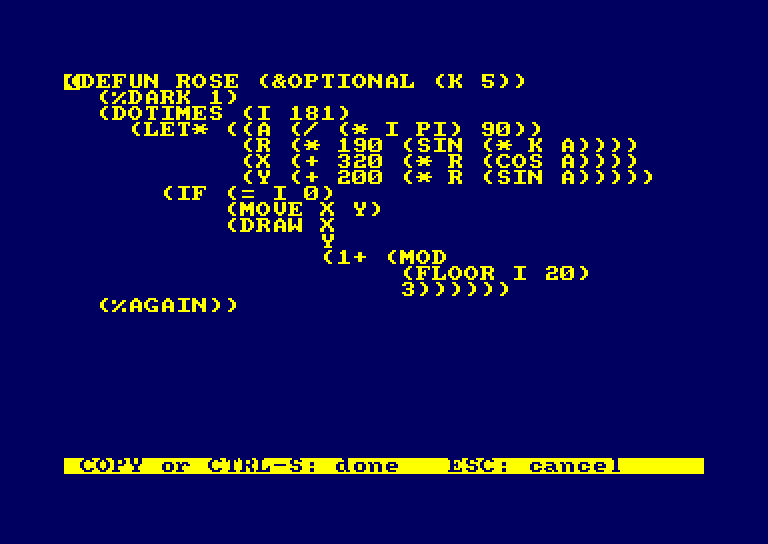(ed 'rose)</code>, pretty-printed"> The function editor: <code>(ed 'rose)</code>, pretty-printed</td><td align="center" valign="top">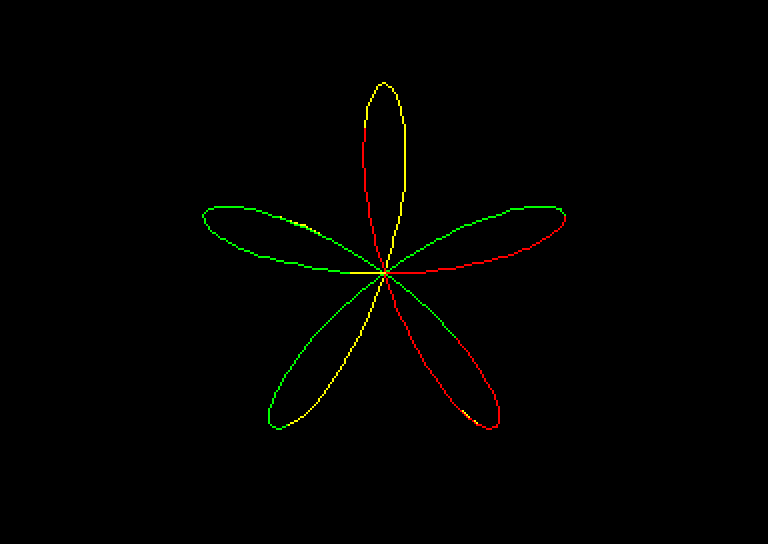(rose)</code>: a rose curve, in floats"> <code>(rose)</code>: a rose curve, in floats</td><td align="center" valign="top">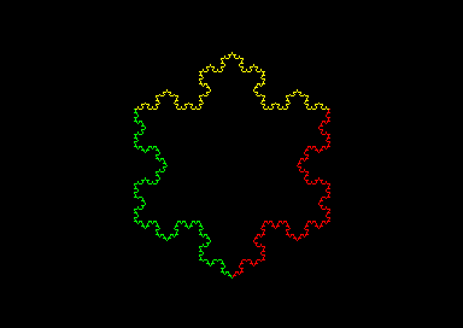(koch 4)</code>: a Koch snowflake, turtle graphics"> <code>(koch 4)</code>: a Koch snowflake, turtle graphics</td></tr>
<tr><td align="center" valign="top">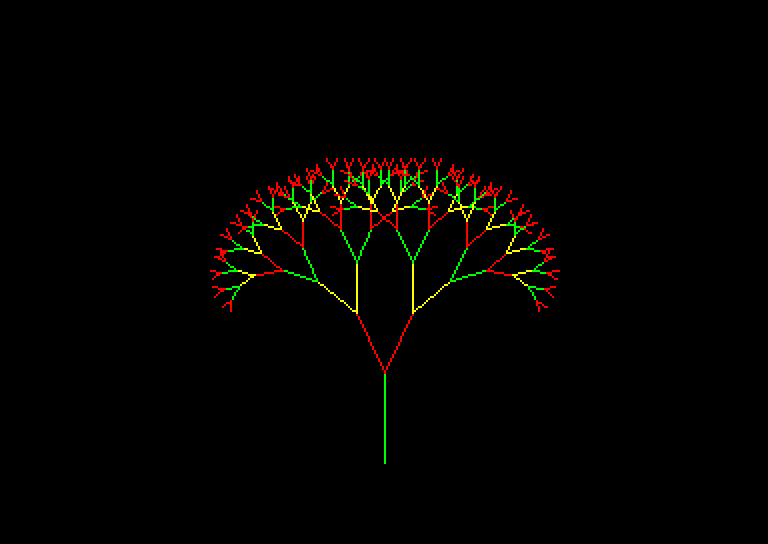(tree)</code>: a recursive tree"> <code>(tree)</code>: a recursive tree</td><td align="center" valign="top">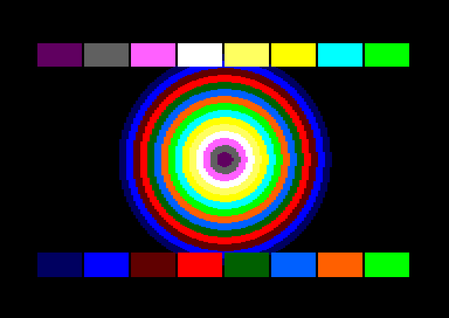(shapes)</code>: discs and boxes in 16 colours"> <code>(shapes)</code>: discs and boxes in 16 colours</td><td align="center" valign="top">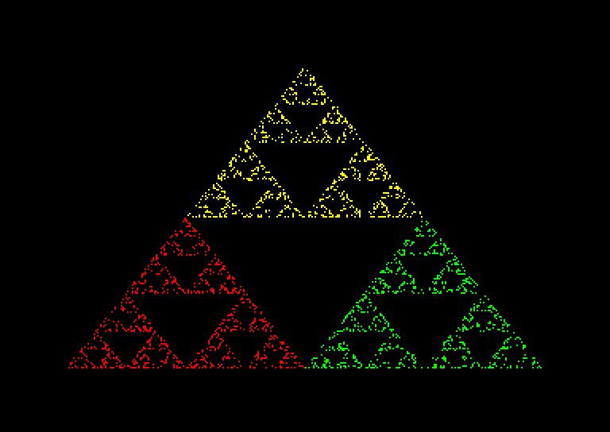(sierpinski)</code>: the chaos game"> <code>(sierpinski)</code>: the chaos game</td><td align="center" valign="top">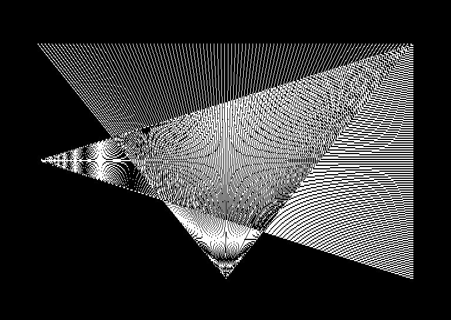(moire)</code>: lines drawn with XOR"> <code>(moire)</code>: lines drawn with XOR</td></tr>
</table>

**The Apfelmaennchen on all six** -- `(load "apfel")`, `(apfel)`, from
the demo disc ([`examples/apfel.lsp`](examples/apfel.lsp)) -- the same
program on each:

<table>
<tr><td align="center" valign="top">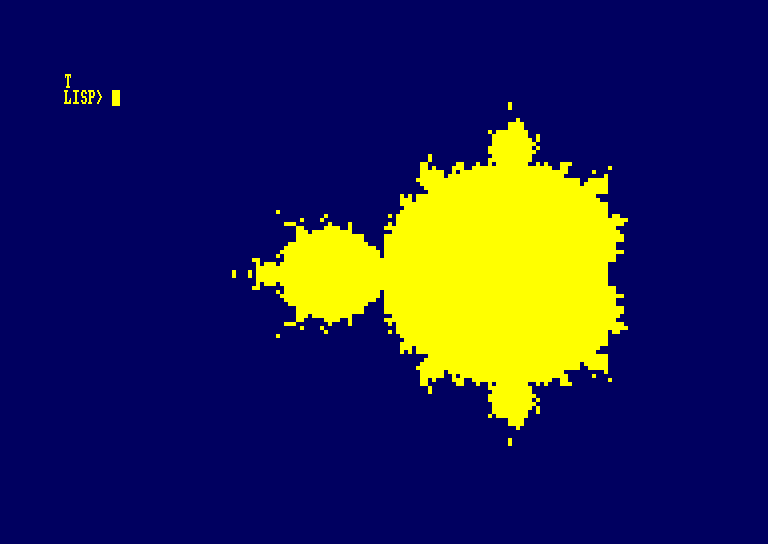 <code>(apfel)</code> on the CPC: mode 2, compiled</td><td align="center" valign="top">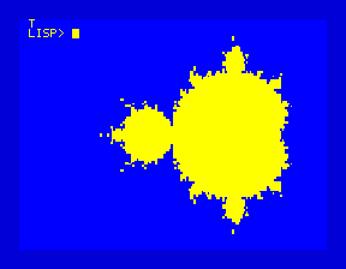 <code>(apfel)</code> on the ZX Spectrum: 256 by 192, compiled</td><td align="center" valign="top">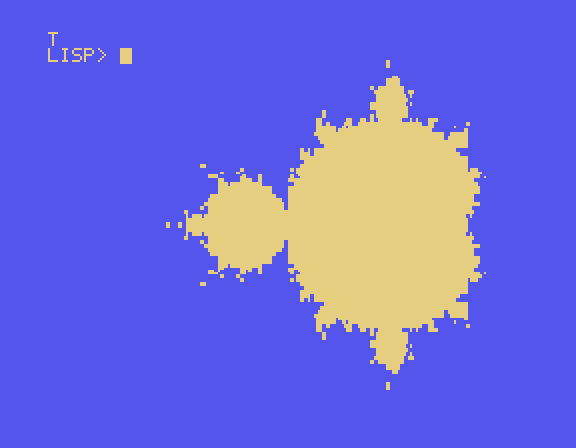 <code>(apfel)</code> on the MSX: 256 by 192, compiled</td><td align="center" valign="top">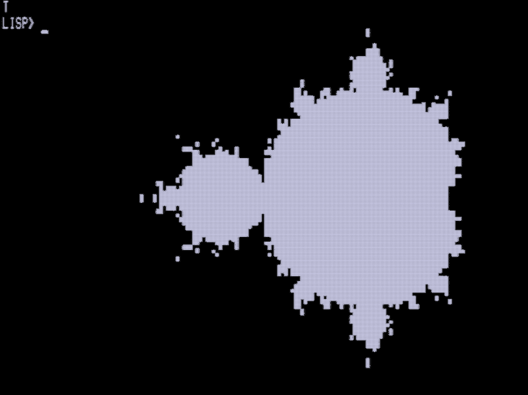 <code>(apfel)</code> on the TRS-80 Model 4: the high-resolution board</td><td align="center" valign="top">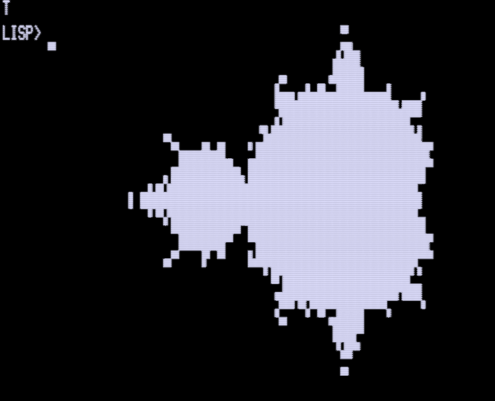 <code>(apfel)</code> on the TRS-80 Model I: in the 2 x 3 blocks</td><td align="center" valign="top"> <code>(apfel)</code> on the Amstrad PCW: one colour, compiled (ZEsarUX; not yet on a real PCW)</td></tr>
</table>

**On the ZX Spectrum +2A, with a DivMMC** (in ZEsarUX; photos of the
real one [below](#on-the-zx-spectrum))

<table>
<tr><td align="center" valign="top">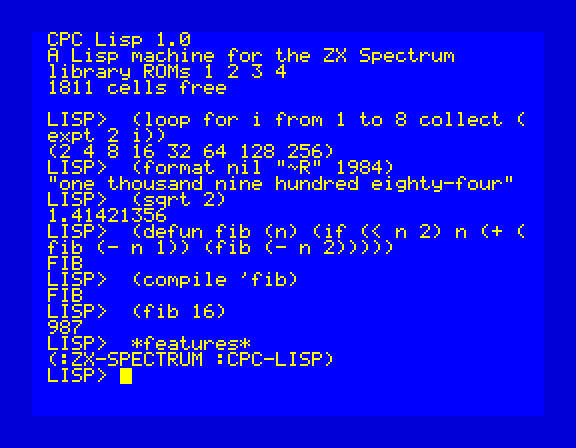loop</code>, <code>format</code>, floats, the compiler"> The REPL, 40 by 24: <code>loop</code>, <code>format</code>, floats, the compiler</td><td align="center" valign="top">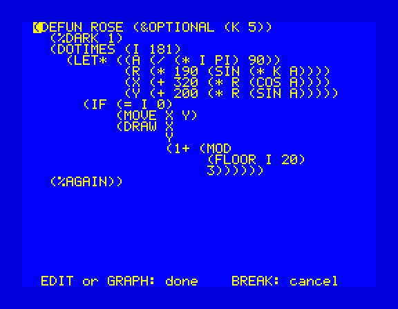(ed 'rose)</code>; EDIT or GRAPH is done"> The function editor: <code>(ed 'rose)</code>; EDIT or GRAPH is done</td><td align="center" valign="top">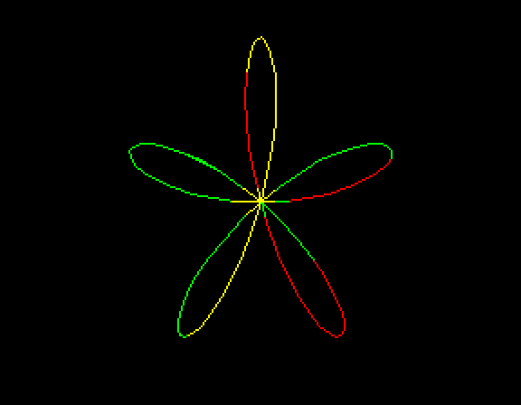(rose)</code>: floats by the Spectrum ROM's calculator"> <code>(rose)</code>: floats by the Spectrum ROM's calculator</td><td align="center" valign="top">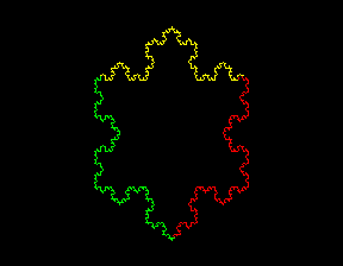(koch 4)</code>"> <code>(koch 4)</code></td></tr>
<tr><td align="center" valign="top">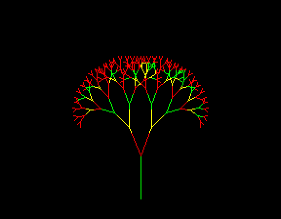(tree)</code>"> <code>(tree)</code></td><td align="center" valign="top">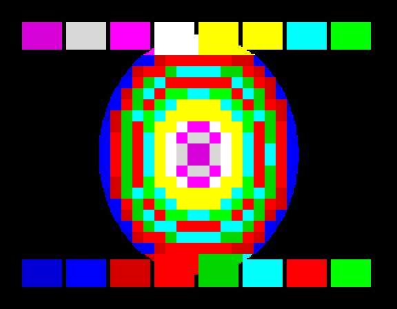(shapes)</code>: a pen colours its 8 by 8 cell -- the Spectrum's colour clash"> <code>(shapes)</code>: a pen colours its 8 by 8 cell -- the Spectrum's colour clash</td><td align="center" valign="top">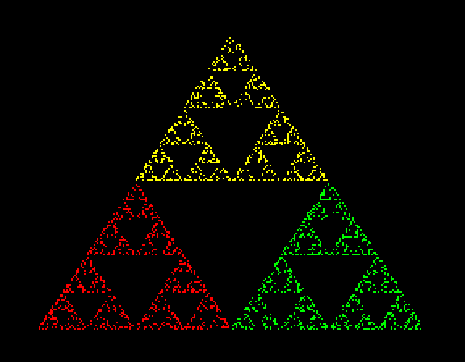(sierpinski)</code>"> <code>(sierpinski)</code></td><td align="center" valign="top">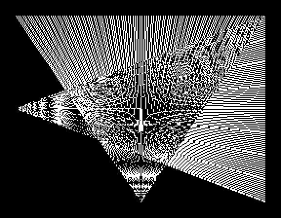(moire)</code>: lines drawn with XOR"> <code>(moire)</code>: lines drawn with XOR</td></tr>
</table>

**On the MSX1, with a memory mapper and Nextor** (in openMSX, a Toshiba
HX-10; photos of a real one and a VG-8020 [below](#on-the-msx))

<table>
<tr><td align="center" valign="top">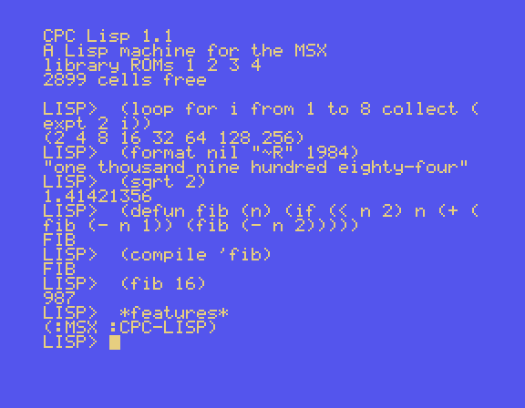 The REPL, 40 by 24: <code>loop</code>, <code>format</code>, floats, the compiler</td><td align="center" valign="top">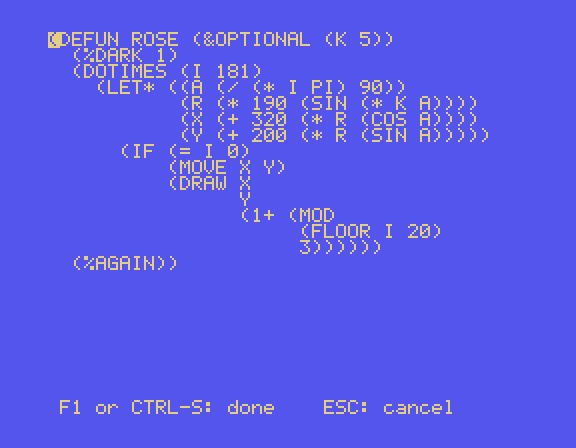 The function editor: <code>(ed 'rose)</code>; F1 is done</td><td align="center" valign="top">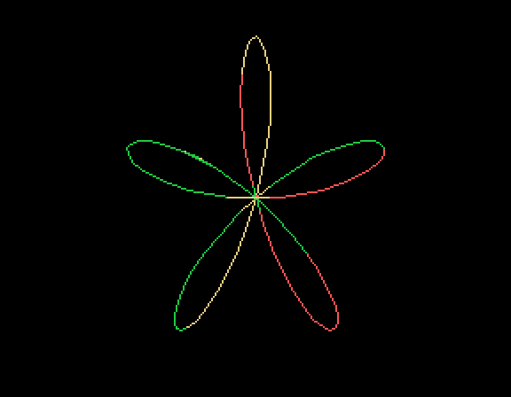 <code>(rose)</code>: floats by the MSX ROM's Math-Pack</td><td align="center" valign="top">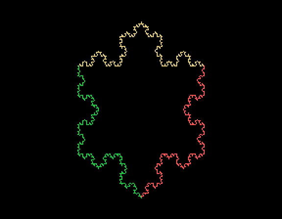 <code>(koch 4)</code></td></tr>
<tr><td align="center" valign="top">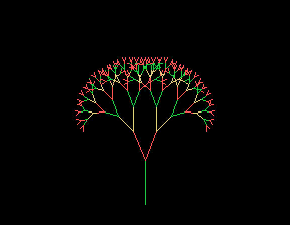 <code>(tree)</code></td><td align="center" valign="top">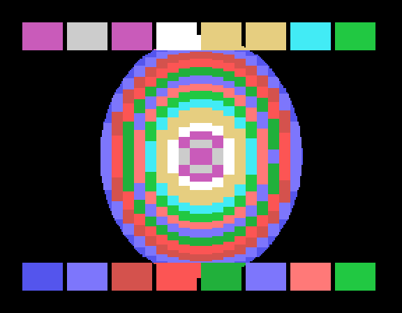 <code>(shapes)</code>: a pen colours 8 pixels across, in one row -- the MSX's colour clash</td><td align="center" valign="top">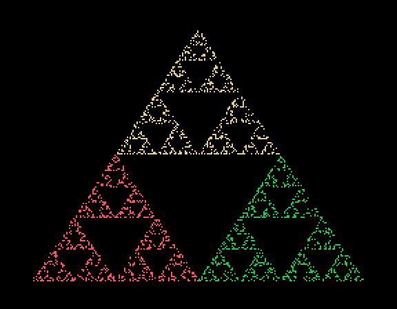 <code>(sierpinski)</code></td><td align="center" valign="top"> <code>(moire)</code>: lines drawn with XOR</td></tr>
</table>

**On the Amstrad PCW 8256** (in ZEsarUX, booted from its own disc -- not yet tested on a real PCW)

<table>
<tr><td align="center" valign="top">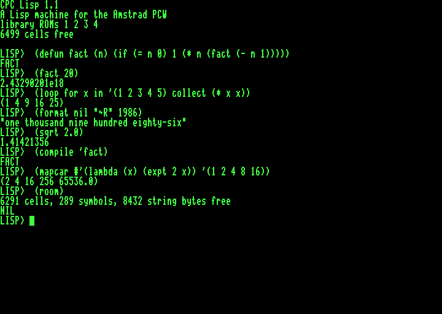 The REPL, 90 by 32: <code>loop</code>, <code>format</code>, floats, the compiler</td><td align="center" valign="top">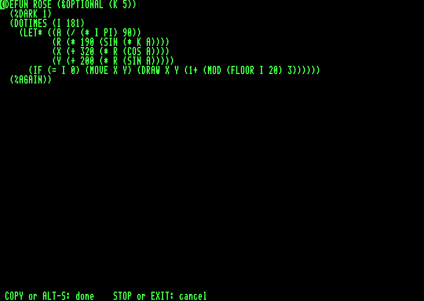 The function editor: <code>(ed 'rose)</code>; COPY is done</td><td align="center" valign="top"> <code>(rose)</code>: floats by our own maths</td><td align="center" valign="top"> <code>(koch 4)</code></td></tr>
<tr><td align="center" valign="top">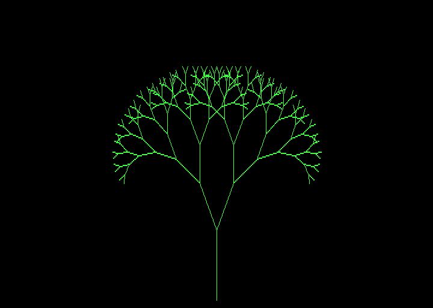 <code>(tree)</code></td><td align="center" valign="top">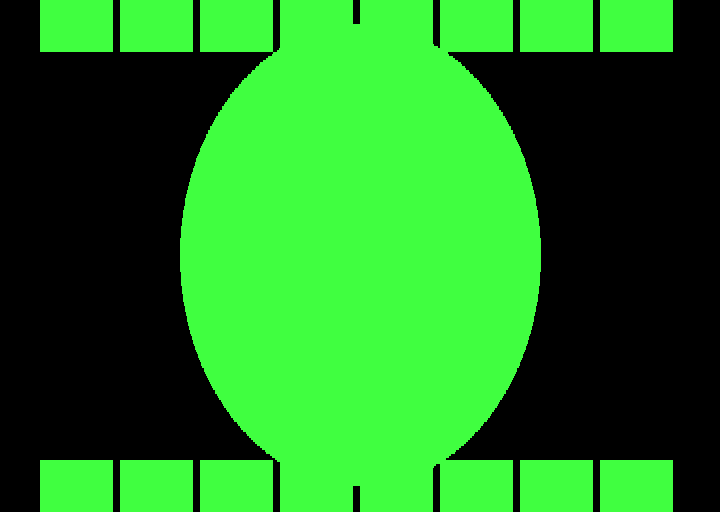 <code>(shapes)</code>: one colour, every pen lights</td><td align="center" valign="top">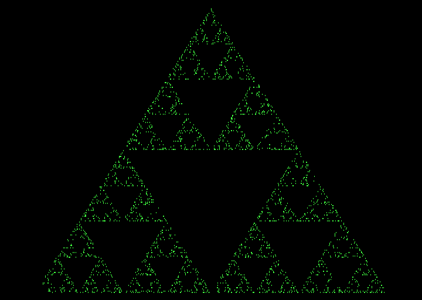 <code>(sierpinski)</code></td><td align="center" valign="top">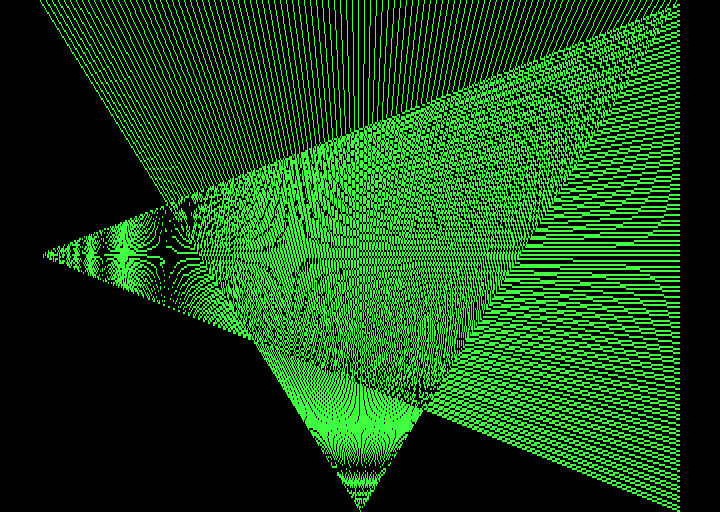 <code>(moire)</code>: lines drawn with XOR</td></tr>
</table>

**On the TRS-80 Model 4, with the high-resolution board**

<table>
<tr><td align="center" valign="top">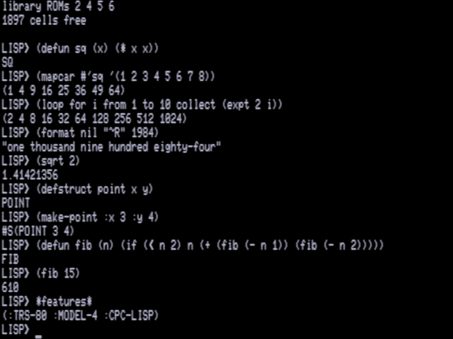 The REPL, 80 by 24</td><td align="center" valign="top">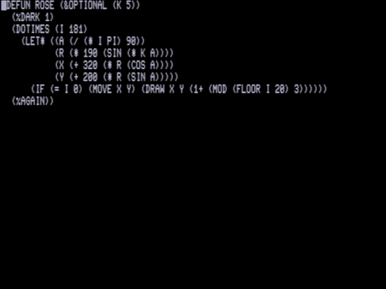(ed 'rose)</code>"> The function editor: <code>(ed 'rose)</code></td><td align="center" valign="top">(rose)</code>: 640 by 240 pixels"> <code>(rose)</code>: 640 by 240 pixels</td></tr>
<tr><td align="center" valign="top">(koch 4)</code>"> <code>(koch 4)</code></td><td align="center" valign="top">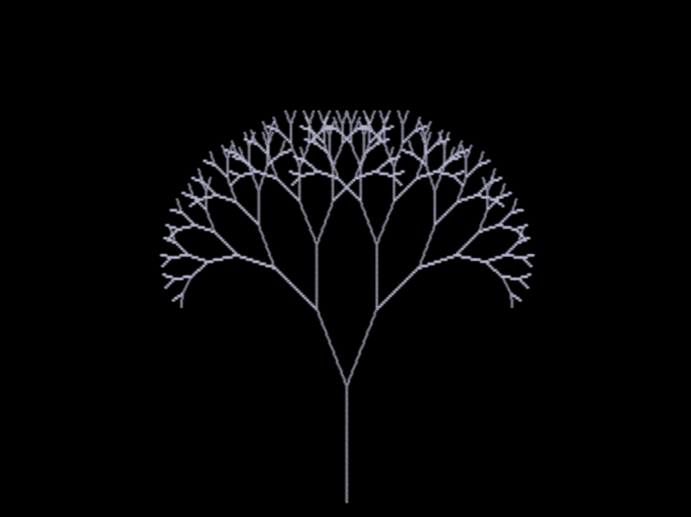(tree)</code>"> <code>(tree)</code></td><td align="center" valign="top">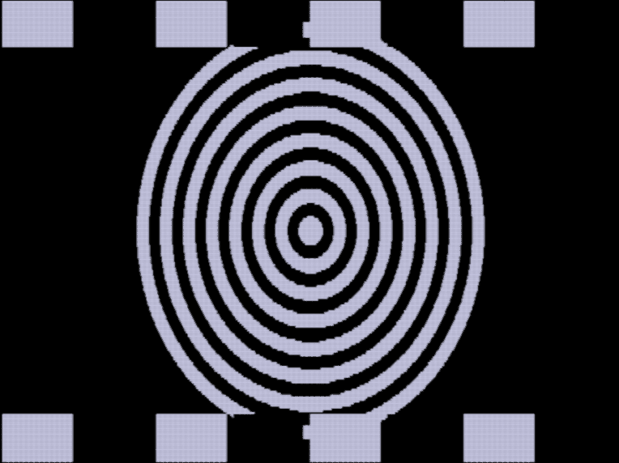(shapes)</code>: discs and boxes, one colour"> <code>(shapes)</code>: discs and boxes, one colour</td></tr>
<tr><td align="center" valign="top">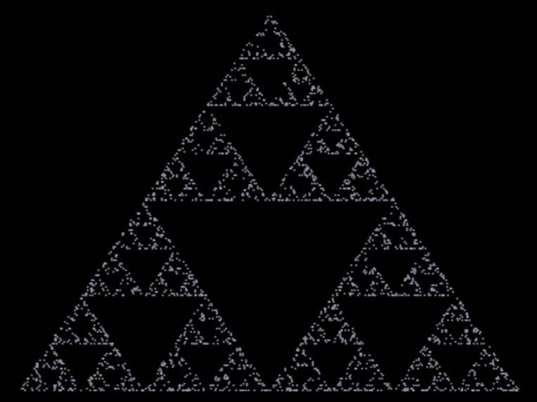(sierpinski)</code>"> <code>(sierpinski)</code></td><td align="center" valign="top">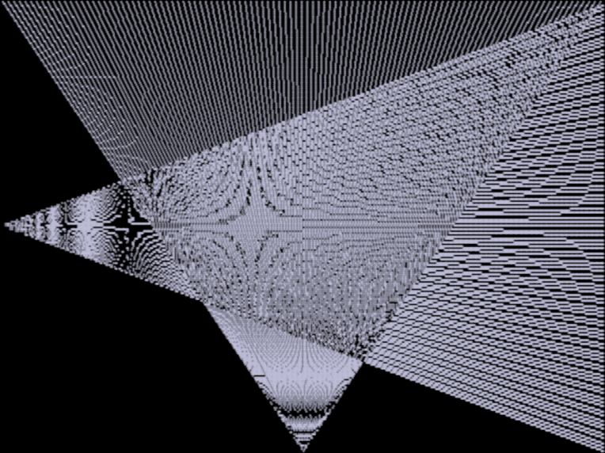(moire)</code>: lines drawn with XOR"> <code>(moire)</code>: lines drawn with XOR</td><td align="center" valign="top">(apfel)</code>, with the text over the graphics"> <code>(apfel)</code>, with the text over the graphics</td></tr>
</table>

**On the TRS-80 Model I with X-MEM/80**

<table>
<tr><td align="center" valign="top">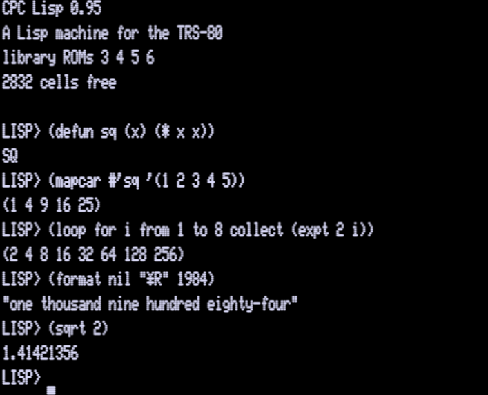 The REPL on a TRS-80 Model I with X-MEM/80</td><td align="center" valign="top">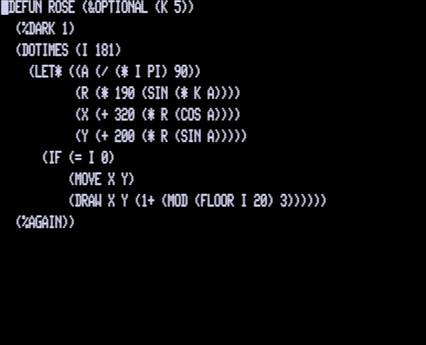 The function editor, 64 by 16</td><td align="center" valign="top">(shapes)</code> in the 2 x 3 blocks"> <code>(shapes)</code> in the 2 x 3 blocks</td></tr>
<tr><td align="center" valign="top">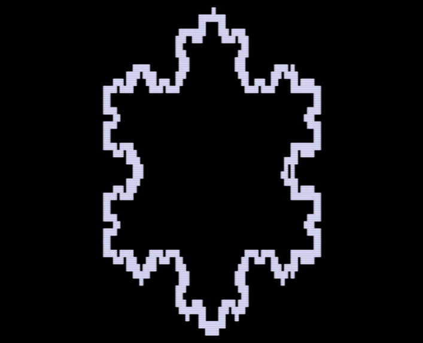(koch 4)</code>"> <code>(koch 4)</code></td><td align="center" valign="top">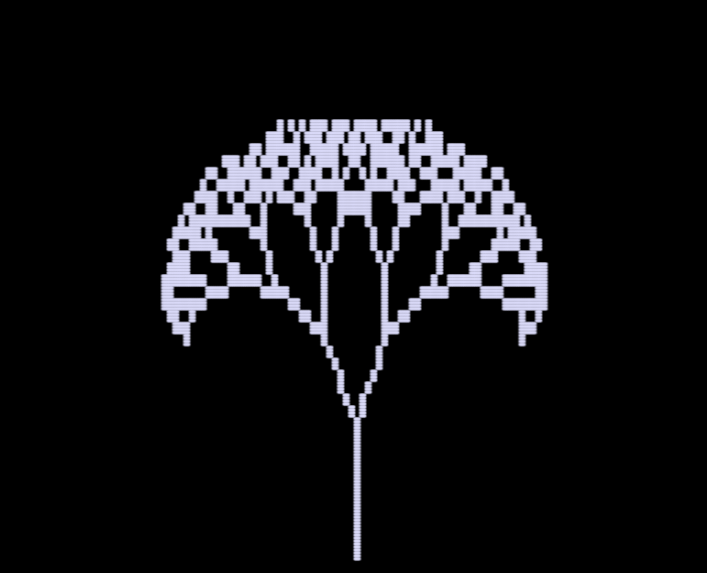(tree)</code>"> <code>(tree)</code></td><td align="center" valign="top">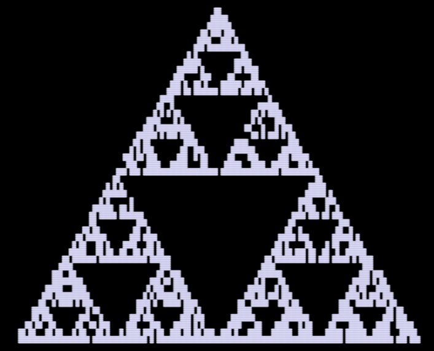(sierpinski)</code>"> <code>(sierpinski)</code></td></tr>
</table>

## What it has

The **core** ROM boots to `LISP>`: integers and floats, symbols, conses,
strings, characters, vectors, closures, special variables, `defmacro` and
backquote, `block`/`catch`/`unwind-protect`, `labels`/`flet`, `setf`, all
of CL's lambda lists, multiple values, catchable errors, tail calls, ESC
to break, a mark-and-sweep garbage collector.

The **library** comes in five more ROMs:

| ROM | file | what |
|---|---|---|
| library 1 | LISPLIB.ROM | the screen, graphics (circles, flood fill, XOR, turtle graphics), sound, keys and joystick; strings and characters; the printers and readers with CL's streams; files through the disc ROM, and a RAM disc on a 6128 (in X-MEM/80 on a TRS-80); the line editor and a full-screen function editor |
| library 2 | LISPLIB2.ROM | lazy loading (programs bigger than memory: functions read from the file when first called, dropped again when the cells run out), floats and the maths functions through the firmware, `format` with all its directives, `sort`, the sequence functions with all their keywords, hash tables, structures, `coerce`, speech, PlayCity and MIDI out on the LambdaSpeak card (Talker/80 and MIDI/80 on a TRS-80), `(basic)` and `\|BOOTLISP` |
| library 3 | LISPLIB3.ROM | about eighty CL functions and macros written in Lisp (`reduce`, `map`, `defstruct`, `typep`, `handler-case`, `with-open-file`...), read from ROM the first time each is used |
| demo | LISPDEMO.ROM | `loop` (the extended one too), string streams, far arrays on the RAM disc, and demo programs: `(demo)` lists them |
| VM | LISPVM.ROM | the bytecode machine, and the compiler: `compile`, `compile-file`, `disassemble` |

It runs on a real 464, with the 1.0 and the 1.1 firmware, and in MAME on
the 464 and the 6128; from disc on a 464 and a 6128 with 512K more and
on a plain 6128, in MAME; on a real TRS-80 Model I and Model III with
X-MEM/80, and in trs80gp; and natively on a real TRS-80 Model 4, with a
FreHD, an HxC and the Improved Grafyx, and in trs80gp. On a TRS-80 the same functions are there but
for the CPC's own -- colours and windows, user-defined characters, the
joystick, `peek`/`poke`, the sound queues, PlayCity, `(basic)`: the
[reference](docs/reference.md) marks them **CPC only**, and
[*On a TRS-80*](#on-a-trs-80) below says what differs.

## Installing the ROMs

**Ready-made images are in [`roms/`](roms/)** -- `LISP.ROM` (the core),
`LISPLIB.ROM`, `LISPLIB2.ROM`, `LISPLIB3.ROM`, `LISPDEMO.ROM` and
`LISPVM.ROM`, 16 KB each; [`roms/README.md`](roms/README.md) says what
each is. Or build your own: `tools/build.sh` makes them in `build/`.
**All six must come from the same build**: the core finds the others by
a signature with the build number, and leaves out any from another build
(they call each other by address).

Any ROM box or ROM board takes them, or the LambdaSpeak card (below).

**ROM numbers.**

* **The core at ROM 0**, with ROMDIS asserted, replaces BASIC: the CPC
  starts in Lisp. (BASIC's ROM obeys ROMDIS on the 464, 664 and 6128.)
  At any other free number, the CPC starts in BASIC, and `|LISP` is to
  start Lisp (built in, not tried yet).
* **The other five at any free numbers from 1 to 6, in any order.** Not
  7: that is the disc ROM (AMSDOS, Parados). The core searches ROMs 1-15
  for them, but the 464's firmware only knows ROMs 0-7.
* **Only the core is needed.** Leave out any of the others and their
  functions are simply not there; the banner lists the library ROMs it
  found (the VM ROM is not listed).
* Like any expansion ROM, each lowers the free memory a little.

**On the LambdaSpeak card** --
[LambdaSpeak 4, aka LambdaSpeak AI](https://github.com/lambdamikel/lambdaspeak4)
([Hackaday](https://hackaday.io/project/206813-lambdaspeak-4-aka-lambdaspeak-ai)),
which serves eight ROMs from flash, uploaded over USB, and does the
speech, PlayCity and MIDI Lisp's `say`, `pc-tone` and `midi-note`
use. CPC Lisp was
developed on it; its own Parados and LS AI ROMs keep their slots:

| slot | ROM number | image |
|---|---|---|
| 2 | 0 | LISP.ROM -- the CPC boots into it |
| 5 | 4 | LISPLIB.ROM |
| 0 | 5 | LISPLIB2.ROM |
| 7 | 6 | LISPLIB3.ROM |
| 3 | 3 | LISPDEMO.ROM |
| 1 | 1 | LISPVM.ROM |
| 4 | 7 | Parados (the card's) -- not touched |
| 6 | 2 | LS AI (the card's) -- not touched |

(Until 0.96 the core was in slot 4 and Parados in 2: 0.97's `(basic)`
and `|BOOTLISP` take slot 2 unless told another.)

Upload the images with the card's ROM loader, with the CPC **switched
off**. From this repository, `python3 tools/card.py lisp` uploads the six
in `build/` (it checks that the CPC is off first, and refuses slots 4
and 6);
`tools/card.py slots` lists the slots. `card.py` drives the uploader of
the LambdaSpeak 4 tools (`~/git/lambdaspeak4/tools`).

**On a 664 or 6128 the card needs its 664/6128 firmware**, flashed while
the card is still on the PC and before it goes in -- the 464 firmware's
disc drive at &FB7E and its disc ROM at 7 would fight the machine's own
controller and AMSDOS for the data bus. That build never answers ROM 7
(slot 4's Parados stays dark; the machine's AMSDOS is the disc ROM), and
its drive is a Vortex controller at &FBF6. The LambdaSpeak 4's
`docs/two-firmwares.md` has why and how to move the card. CPC Lisp's
ROMs from the card's slots have not been tried on a real 6128 yet; its
FutureOS version has (below).

**BASIC and back**, with no PC: `(basic)` at `LISP>` makes the core's
slot silent and resets -- the CPC comes up in BASIC; there, `|BOOTLISP`
makes it ROM 0 again and resets into Lisp. (Both take the slot if it is
not 2: `(basic 3)`, `|BOOTLISP,3`. Everything in RAM goes: save first.)
From the PC, with the CPC off, `tools/card.py basic` and
`tools/card.py number 2 0` do the same.

**On a ROM board or in EPROMs**: one 16 KB ROM (27128) each. The core at 0
needs a board that can assert ROMDIS, or another number and `|LISP`. On a
6128 or 664 the internal AMSDOS is ROM 7 and ignores ROMDIS: never put
anything at 7 there.

## Building and testing

Needs rasm, Python 3 and MAME with the CPC ROMs (paths in `tools/build.sh`).

    tools/build.sh                 # the six ROMs in build/, and MAME romsets
                                   # with the core at ROM 0
    tools/mame.sh                  # a MAME window to play in (-m 6128 for a 6128)
    tools/run.sh file.lsp          # type a file at it in MAME, print the transcript
    tools/test.sh                  # the regression tests in test/ (-m 6128 for a 6128)

What depends on the CPC is in `mach/cpc/`; the rest is portable Z80
code. [`mach/README.md`](mach/README.md) is the interface between them,
for a port to another Z80 machine (`MACH=<machine> tools/build.sh`).

The build runs the compiler on itself first (`tools/bootstrap.py`, see
[the design](docs/design.md#the-bootstrap)).

**Typing a tilde** (`format`'s `~A`, `~%`...): the CPC has no `~` key --
it is **CTRL + 2** (in MAME, Right Alt + 2).

## From disc

No ROM board? CPC Lisp loads from disc too, on a 464, 664 or 6128 with
AMSDOS or Parados -- `RUN"LISP` -- in two versions:

**With a 512K RAM expansion** that banks the DK'tronics way --
Revaldinho's universal RAM cards, the DK'tronics 512K, an X-MEM's RAM --
the six images run in the expansion: all of CPC Lisp, the compiler too,
and a RAM disc `M:` of 399 KB in its free blocks -- which also holds
far arrays (`make-far-array`, `far-ref`) and programs loaded with
`(load "m:big" :lazy t)`, each function read in when first called.

    CPC Lisp 1.2.1
    A Lisp machine for the Amstrad CPC, 512K
    library ROMs 1 2 3 4
    5521 cells free

**On a plain 6128** (or a CPC with 64 KB more), five images fill the 128
KB: everything but the compiler, without a RAM disc, and with about 2400
cells.

    CPC Lisp 1.2.1
    A Lisp machine for the Amstrad CPC, 128K
    library ROMs 1 2 3 4
    2430 cells free

**The discs are ready in [`discs/`](discs/)**, and with each
[release](https://github.com/lambdamikel/cpc-lisp-machine-os/releases) --
`cpclisp512.dsk` and `cpclisp6128.dsk`, `cpclispfos.dsk` and
`cpclispfos-n.dsk` for FutureOS ([below](#under-futureos)), a test disc for the ROMs' use of a RAM expansion, and
the demo disc `cpclisp-demo.dsk` with the Apfelmaennchen (`(load
"apfel")`, `(apfel)`), and the classics disc `cpclisp-classics.dsk`:
ELIZA, symbolic differentiation, the animal game that learns, Lisp in
Lisp, Conway's Life, tic-tac-toe by minimax and SICP's Huffman codes
(`(load "classics")` lists them). Each but the
demo and the classics disc has `HWTEST.LSP`, a test of
the real machine (`(load "hwtest")`, `(hwtest)`). Or build them: `MACH=cpc512 tools/build.sh` makes
`build/cpc512/cpclisp512.dsk`, `MACH=cpc6128 tools/build.sh`
`build/cpc6128/cpclisp6128.dsk`. `(basic)` goes back to BASIC, and
`RUN"LISP` starts Lisp again (with the 512K, the RAM disc's files are
still there). [`mach/cpc512/README.md`](mach/cpc512/README.md) and
[`mach/cpc6128/README.md`](mach/cpc6128/README.md) have how they work.
Both run on a real 464 with Revaldinho's 512K card -- in its DIP
configuration 4 (2026-11-12): [`discs/README.md`](discs/README.md).

## Under FutureOS

[FutureOS](https://futureos.de), TFM's operating system for the CPC,
takes the place of BASIC and the firmware, with a fast graphical
desktop of its own. **Since 1.0 CPC Lisp runs on FutureOS itself**: no
firmware, FutureOS stays resident, and Lisp loads, saves and prints
through FutureOS's own routines -- from any of its drives. It needs a
464, 664 or 6128 with FutureOS and a 512K RAM expansion that does the
6128's C3 mode (Revaldinho's card: configuration 8 on a 464, 0 on a
6128).

    SPACE, A        read drive A (or E...): discs/cpclispfos-n.dsk there
    LISP.64K        tag it: the pointer on it, COPY
    X               RUN -- CPC Lisp loads, and LISP> comes up
    (reset)         back to FutureOS's desktop, the drives still read;
                    to start again: D, tag LISP.64K, X

    CPC Lisp 1.2.1
    A Lisp machine for the Amstrad CPC on FutureOS
    library ROMs 1 2 3 4
    4713 cells free

It is all of CPC Lisp -- the compiler, graphics, sound, speech through
the LambdaSpeak card, the editors, floats (from the lower ROM's maths:
FutureOS has none) -- with its own keyboard scan, graphics and sound in
a machine page of its own, and files on **any FutureOS drive**: `(dir
"e:")` lists one, `(cd "e:")` makes it the drive for names without one,
and the RAM disc `M:` (191 KB) and far arrays live in the expansion's
free blocks. Text comes through FutureOS's fast character output: it is
noticeably quicker than the firmware's. `LISP.64K` checks each image it
loads and names a damaged one on the desktop. It passed on Mike's 6128
(2026-11-19) and 464 (2026-11-20): `(hwtest)` 7 yes, graphics, sound,
speech, files on the Gotek and on the LambdaSpeak card's drives, three
starts with `(reset)` between. [`mach/fos/README.md`](mach/fos/README.md)
has what it needs, how it is arranged, and what was tested where.

**The firmware island** (`discs/cpclispfos.dsk`, since 0.99) is the
first way it ran there, and still works: `LISP.64K` puts FutureOS's RAM
aside in the expansion, starts the CPC's own firmware for itself -- found
in the lower ROM of whichever CPC it is -- and runs the 512K version
through the machine's disc ROM (AMSDOS, Parados: drives A and B), giving
FutureOS everything back at `(reset)`. The video below shows it.
[`mach/futureos/README.md`](mach/futureos/README.md) has the details.

[CPC LISP running on the CPC 6128 with FutureOS -- Vortex Floppy Emulation with LambdaSpeak AI](https://youtu.be/s4BsQOroQUc) (5:08)

## On the ZX Spectrum

The same Lisp -- the same six images, built from the same sources, the
compiler included -- runs on a **ZX Spectrum 128K with a DivMMC**: a
+2A, +2B or +3, or a 128 or a grey +2 (the loader tells them apart). The
six images take the 128K's banks 0, 1, 3, 4, 6 and 7; what is the
Spectrum's -- the screen, the keys, graphics, sound, files through
esxDOS, floats, a RAM disc -- lives in the DivMMC's own RAM, two of its
8 KB pages, mapped in only while one of its routines runs
(`mach/spectrum/`).

    CPC Lisp 1.2.1
    A Lisp machine for the ZX Spectrum
    library ROMs 1 2 3 4
    1811 cells free

**On a real +2A** -- photos, on a Sony monitor:

<table>
<tr><td colspan="4" align="center" valign="top"><a href="docs/images/zx-real-setup.jpg">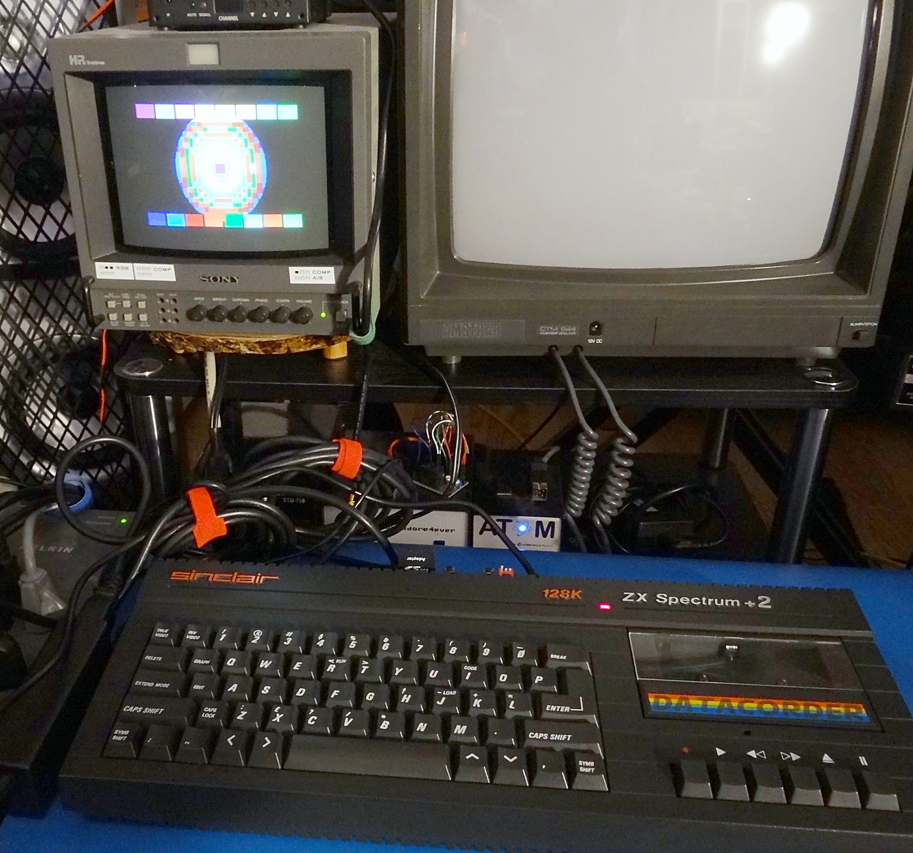</a> The +2A, its DivMMC at the back: a Koch snowflake</td></tr>
<tr><td align="center" valign="top"><a href="docs/images/zx-real-demo.jpg">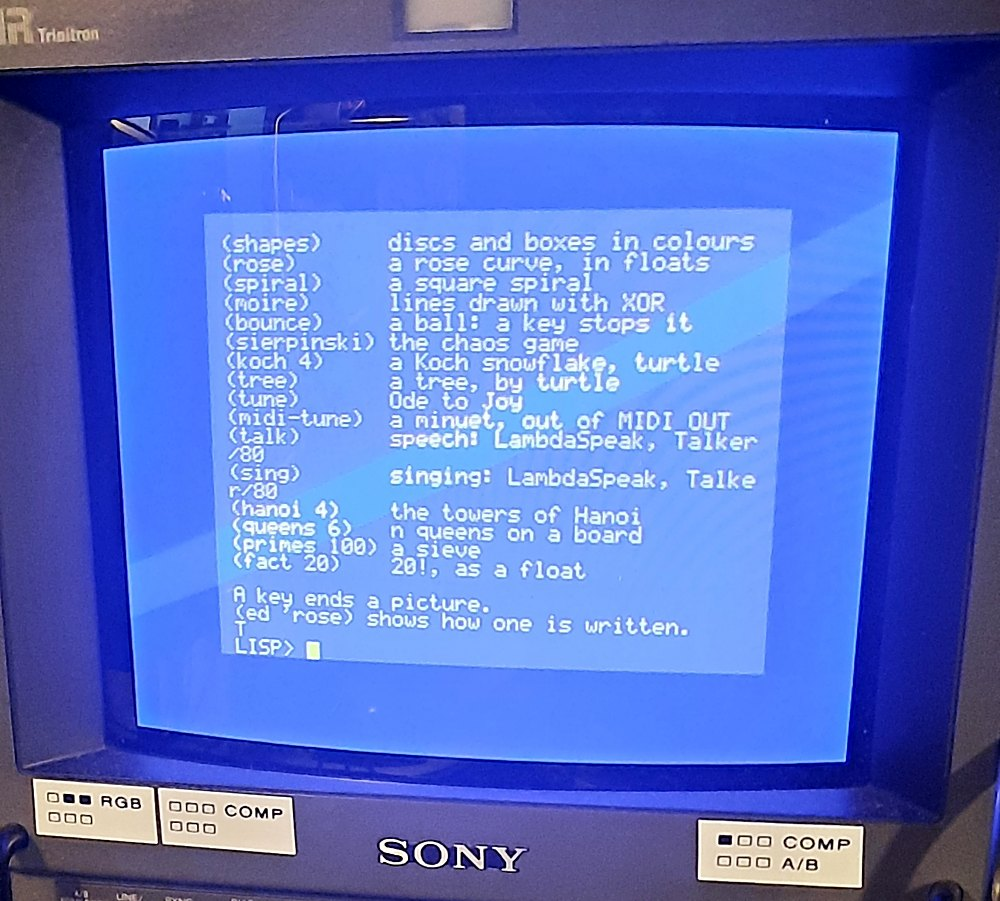</a> <code>(demo)</code>: the demos</td><td align="center" valign="top"><a href="docs/images/zx-real-ed.jpg">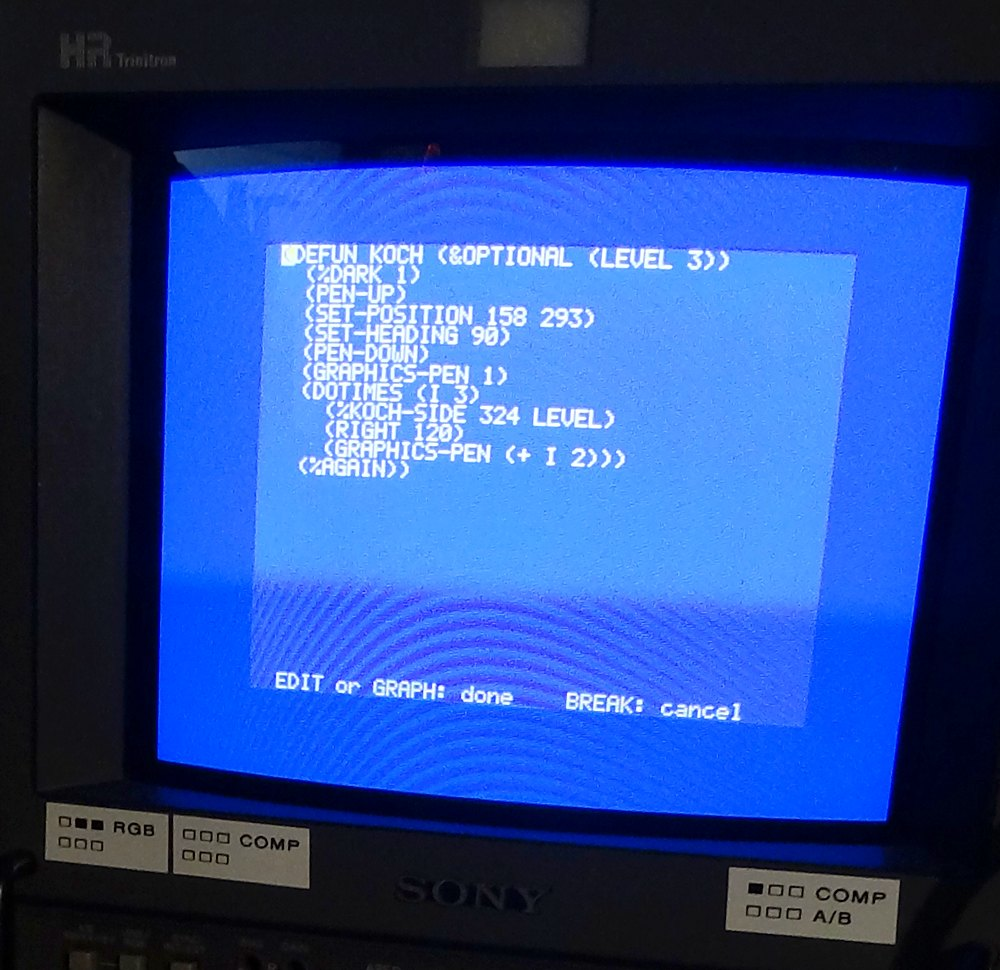</a> The function editor: <code>(ed 'koch)</code></td><td align="center" valign="top"><a href="docs/images/zx-real-shapes.jpg">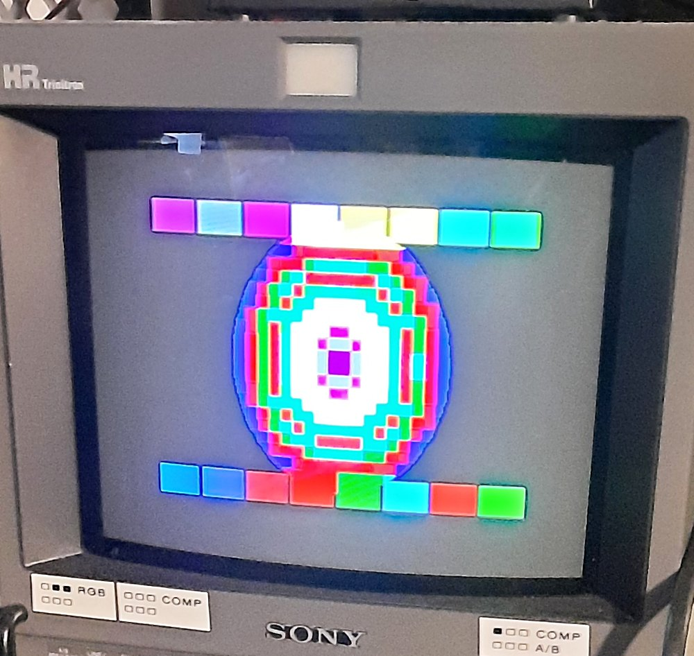</a> <code>(shapes)</code> and its colour clash</td><td align="center" valign="top"><a href="docs/images/zx-real-tree.jpg">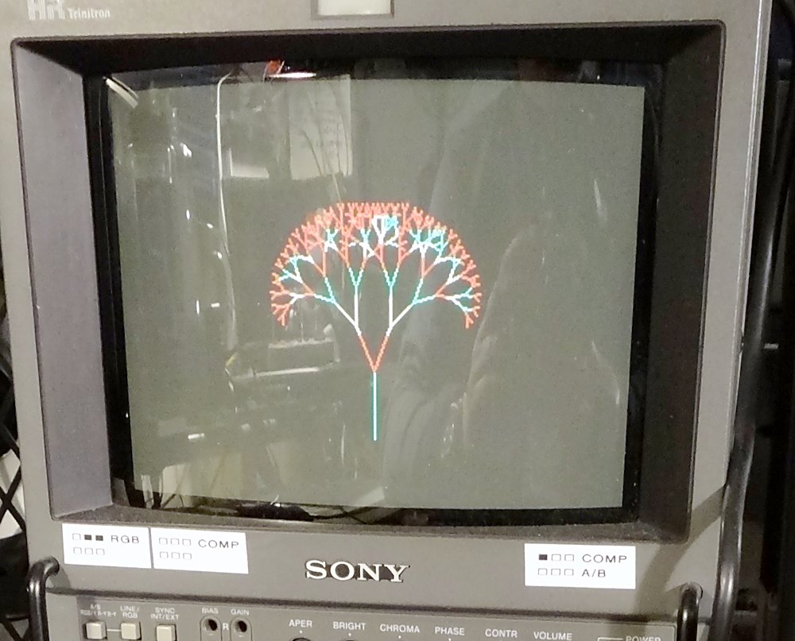</a> <code>(tree)</code></td></tr>
</table>

[CPC Lisp on the Sinclair ZX Spectrum +2 -- Common Lisp on the Speccy!](https://youtu.be/4GQVhU6cOpw) (6:02)

**What it needs**: a 128K Spectrum and a DivMMC (or a compatible
interface) with **128 KB of RAM** and **esxDOS** on its SD card.

**The files**: [`discs/spectrum/`](discs/spectrum/), or
`cpc-lisp-1.2.1-spectrum.zip` with each
[release](https://github.com/lambdamikel/cpc-lisp-machine-os/releases)
since 1.1 -- `LISP.TAP`, `HWTEST.LSP`, the Apfelmaennchen and the
classics. Copy them to the SD
card, into a folder of their own (`LISP`, say): Lisp's files are that
folder's. Or build them: `MACH=spectrum tools/build.sh` (rasm and Python
3, as for the CPC) makes `build/spectrum/sd/`.

**Starting**: switch on; esxDOS starts the Spectrum in 48 BASIC ("(C)
1982 Amstrad"). Press the DivMMC's **NMI** button, go into the `LISP`
folder (ENTER), move onto `LISP.TAP` with the cursor keys and press
**ENTER**: esxDOS loads it as a tape, in a few seconds. `(quit)` starts
the Spectrum afresh -- NMI, `LISP.TAP`, ENTER to come back; the RAM disc
`M:` keeps its files.

**What is different**: 40 by 24 characters in a font of its own;
graphics 256 by 192, where a pen colours its 8 by 8 cell -- the
Spectrum's colour clash (screenshots above); the CPC firmware's sound
manager on the AY, envelopes and all; MIDI out of the RS232/MIDI socket
(through an adapter to a MIDI socket); floats by the Spectrum ROM's
calculator; a RAM disc `M:` of 72 KB in the DivMMC's spare RAM (more on
a bigger one) and far arrays there; about 1800 cells. **EDIT** is COPY,
**GRAPH** is CTRL-S, **BREAK** is ESC; SYMBOL SHIFT gives `[ ] { } ~ |
\` on Y U F G A S D. [`mach/spectrum/README.md`](mach/spectrum/README.md)
has it all.

**It runs on a real +2A** with a DivMMC and esxDOS 0.8.5 (2026-11-21):
`(hwtest)` -- the cells, the compiler, files on the SD card, lazy
loading, the RAM disc and far arrays, the ROM's calculator, the colour
pens -- all yes; the keys, `(tune)`, `(rose)`. It was made in
[ZEsarUX](https://github.com/chernandezba/zesarux), headless:
`tools/spectrum/zx.py` types a file at it, `test.sh` runs the
regression tests, `esxtest.sh` the real esxDOS from an SD card image.

## On the MSX

The same Lisp -- the same six images, built from the same sources, the
compiler included -- runs on an **MSX1** (or any later MSX) with a
**memory mapper** and **MSX-DOS 2 or Nextor**: an MSX SD Mapper &
Megaram 512 KB cartridge, say, which brings both and an SD card.
`LISP.COM` asks DOS for eight of the mapper's 16 KB segments -- the six
images and two of the MSX's own: the screen, the keys, graphics, sound,
files through DOS, floats, a RAM disc -- and runs the images at &C000,
where DOS keeps its own segment while Lisp runs (`mach/msx/`).

    CPC Lisp 1.2.1
    A Lisp machine for the MSX
    library ROMs 1 2 3 4
    2899 cells free

**On a real Toshiba HX-10** -- photos, on a Sony monitor; the cartridge
is in the slot behind the keyboard:

<table>
<tr><td colspan="2" align="center" valign="top"> <code>(shapes)</code>: a pen colours 8 pixels across -- the MSX's colour clash</td><td colspan="2" align="center" valign="top"> The function editor: <code>(ed 'koch)</code></td></tr>
<tr><td align="center" valign="top"> A Koch snowflake</td><td align="center" valign="top"> <code>(sierpinski)</code>: the chaos game</td><td align="center" valign="top"> <code>(shapes)</code>, from the side</td><td align="center" valign="top"> The editor, from the side</td></tr>
</table>

**And on a Philips VG-8020**, with the same cartridge and SD card:

<table>
<tr><td align="center" valign="top"> <code>(life)</code> from the classics: a glider and a blinker</td><td align="center" valign="top"> The function editor: <code>(ed 'life)</code></td></tr>
</table>

**What it needs**: an MSX with a memory mapper that has **144 KB free**
-- nine segments; with the cartridge's 512 KB the rest is a RAM disc of
271 KB -- and **MSX-DOS 2 or Nextor**. The MSX SD Mapper & Megaram's
switches: **ON** (its RAM) and **MP** (a mapper, not MegaRAM).

**The files**: [`discs/msx/`](discs/msx/), or `cpc-lisp-1.2.1-msx.zip`
with each [release](https://github.com/lambdamikel/cpc-lisp-machine-os/releases)
since 1.2 -- `LISP.COM`, `LISP.IMG`
(the images, 128 KB), `HWTEST.LSP`, the Apfelmaennchen and the classics.
Copy them to the SD card, into a folder of their own (`LISP`, say):
Lisp's files are DOS's current folder's. Or build them: `MACH=msx
tools/build.sh` (rasm and Python 3, as for the CPC) makes
`build/msx/sd/`.

**Starting**: at DOS's prompt, `CD LISP`, then `LISP`. `(quit)` goes
back to DOS; Lisp gives the mapper's segments back, and the RAM disc
`M:` with them.

**What is different**: 40 by 24 characters in the Spectrum port's font;
graphics 256 by 192 in the VDP's screen 2, where a pen colours the 8
pixels across its own, in that one row -- the MSX's colour clash, finer
than the Spectrum's 8 by 8 cells: in `(shapes)` the rings step 8 pixels
at a time across and go smoothly down. The VDP's 15 colours stand in
for the CPC's 27. The CPC firmware's sound manager on the PSG,
envelopes and all; floats by the main ROM's Math-Pack (BASIC's maths: a
`sin` takes 0.15 s); a RAM disc `M:` in the mapper's spare segments, and
far arrays there; about 2900 cells. **F1** (or SELECT) is COPY, **F2**
is CTRL-S, **ESC** or **STOP** breaks, **GRAPH** is a second SHIFT. No
speech, no MIDI.
[`mach/msx/README.md`](mach/msx/README.md) has it all.

**It runs on a real Toshiba HX-10** with an MSX SD Mapper & Megaram 512
KB and Nextor 2.1.0 (2026-11-22): `(hwtest)` -- the cells, the compiler,
files on the SD card, lazy loading, two files open at once, the RAM disc
and far arrays, the ROM's Math-Pack, the colour pens -- 10 yes; the
keys, the demos, sound, ESC, `(quit)` back to DOS. And on a Philips
VG-8020, where GRAPH stood in for SHIFT until a reseated keyboard
connector brought it back.
It was made in
[openMSX](https://openmsx.org/), headless: `tools/msx/msx.py` types a
file at it, `test.sh` runs the regression tests.

## On the Amstrad PCW

The same Lisp -- the six images, the compiler included -- runs on an
**Amstrad PCW 8256 or 8512** (the Schneider Joyce), booted from **a disc
of its own**: no CP/M, no ROM -- the machine is Lisp's from the boot
sector on (`mach/pcw/`).

    CPC Lisp 1.2.1
    A Lisp machine for the Amstrad PCW
    library ROMs 1 2 3 4
    6499 cells free

**What it needs**: a PCW 8256 or 8512 (256 or 512 KB) and the disc in
drive A -- a Gotek serves the image as it is.

**The disc**: [`discs/pcw/`](discs/pcw/), or with each
[release](https://github.com/lambdamikel/cpc-lisp-machine-os/releases)
since 1.2 (`cpc-lisp-1.2.1-pcw.dsk`, `-pcw-classics.dsk`) --
`cpclisp-pcw.dsk`, the one that boots (`LISP.IMG`, `HWTEST.LSP`,
`APFEL.LSP`), and `cpclisp-pcw-classics.dsk`, the examples. Or build them: `MACH=pcw
tools/build.sh` makes both in `build/pcw/`. Switch on with the disc in
A (or SHIFT, EXTRA and EXIT): a bar fills as the eight parts load, then
the banner. `(quit)` boots whatever disc is in A again.

**How it works**: the PCW's memory is blocks of 16 KB, four seen at a
time. Lisp's RAM is three of them, always there; the six images and two
machine pages take turns at &C000; the screen, the keyboard and the RAM
disc are seen for a moment when a routine needs them. Our boot sector
reads our loader, which reads `LISP.IMG` through CP/M's directory. The
screen: 90 by 32 characters in a bold font of our own, scrolled by the
PCW's roller RAM; graphics on the 640 middle pixels of its 720 by 256,
one colour. Discs: our own uPD765 routines on CP/M's file system, so CP/M
reads what Lisp saves. Floats: + - * / as the Spectrum's, `sqrt`, `exp`,
`log`, `sin`, `cos`, `tan`, `atan` by our own series. A RAM disc `M:` in
the blocks left: 47 KB on an 8256, 303 KB on an 8512. **COPY** (or f1)
is COPY, **ALT** is CTRL, **STOP** or **EXIT** breaks, **1/2** gives `` ` ``
and the paragraph sign `\`. Sound: the beeper, and a DKTronics sound
generator's AY if there is one. No speech, no MIDI, no colours.
[`mach/pcw/README.md`](mach/pcw/README.md) has it all.

**It runs in ZEsarUX** (13.0, an emulated 8256 and 8512, headless:
`tools/pcw/pcw.py` boots its disc and types a file at it, `test.sh` runs
the regression tests -- 43 of 43 -- and `(hwtest)` says 10 yes on both),
**and in MiSTer's PCW core** (an FPGA PCW: the disc in `games/Amstrad
PCW/`, drive A, Reset; for the AY switch *DKTronics I/F* on in its menu),
where `(hwtest)` passes too.
**It has not been tested on a real PCW yet**: the boot on a 3" drive,
the disc routines' timing, the keyboard's layout (MAME's UK PCW) and the
beeper are still to be seen on one. ZEsarUX runs its PCW's Z80 at 3.49
MHz, a real one at 4: the speeds measured there should be some 14%
better on the machine.

## On a TRS-80

The same Lisp -- the same six images, built from the same sources --
runs on a **TRS-80 Model I or Model III** with Michael Wessel's and Mark
Pruden's [X-MEM/80](https://github.com/lambdamikel/x-mem-80), 512 KB in
16 KB pages: the images run unchanged in its window at &C000. What is the
TRS-80's -- the screen, the keys, graphics in the 2 x 3 blocks, sound on
the cassette port, floats through the Level II ROM, files through LDOS,
a RAM disc in X-MEM/80's spare pages, speech through Talker/80, MIDI
through MIDI/80 -- is in `mach/trs80/`.

    CPC Lisp 1.2.1
    A Lisp machine for the TRS-80
    library ROMs 3 4 5 6
    2315 cells free

**What it needs**: a Model I or III; X-MEM/80 with its jumper in X-MEM
mode (not SuperMem); a disc drive, real or emulated. Talker/80 for
speech, MIDI/80 for MIDI and a printer are optional.

**Talker/80 on a Model I: reprogram its U1 first.** The Model I
Talker/80's address decoder (U1, a GAL22V10) answers ports 64-67 as
well as 11 -- the VS-100's ports -- and X-MEM/80's page registers are 65
and 66: every page switch lands in Talker/80 as text, and it falls
silent. Program U1 with
[`Talker80-decoder-xmem.jed`](https://github.com/lambdamikel/Talker-80/blob/master/src/gal22v10/m1/Talker80-decoder-xmem.jed) from the Talker/80 repository
([why](https://github.com/lambdamikel/Talker-80#the-model-1-address-decoder-and-x-mem80)); the VS-100 and TRS Voice Synthesizer modes are unchanged.
The Model III Talker/80 needs nothing.

**The disc**: ready to boot with each
[release](https://github.com/lambdamikel/cpc-lisp-machine-os/releases) --
`cpc-lisp-1.2.1-trs80-model1` and `-model3`, as `.dsk` for emulators and
`.hfe` for a Gotek (the `.dsk` files are in [`discs/`](discs/) too).
X-MEM/80 must be in its 16 KB mode (X-MEM/80, not SuperMem) for all of
the RAM disc. Or build it: `MACH=trs80 tools/build.sh` (rasm and Python 3, as for the
CPC, above) makes `build/trs80/lisp-a.dsk` for a Model I -- LDOS 5.3.1,
single density, JV1, with `LISP/CMD` and the seven images on it,
compressed -- and `build/trs80/lisp-m3.dsk` for a Model III -- LDOS
5.1.4, double density, JV3. The classics -- ELIZA, symbolic
differentiation, the animal game, Lisp in Lisp, Life, tic-tac-toe,
Huffman codes -- are on a data
disc for a second drive: `cpclisp-trs80-classics-model1.dsk` or
`-model3.dsk` (`(load "classics")`).

**Starting**: boot that disc, give LDOS the date (and on a Model I the
time), and at `LDOS Ready` type

    LISP

It loads the images into X-MEM/80's pages and starts; without X-MEM/80
in its X-MEM mode it says so and goes back to LDOS. `(quit)` goes back to
LDOS; the RAM disc `M:` keeps its files.

**In an emulator**: [trs80gp](http://48k.ca/trs80gp.html) has X-MEM/80
for the Model I:

    trs80gp -m1 -mem xmem80 -d0 build/trs80/lisp-a.dsk

(`tools/trs80/play.sh` does that, and types the date, the time and
`LISP` for you.)

**What is different**: the screen is 64 by 16 and the graphics 128 by
48 blocks, in one colour; sound is one voice; BREAK is ESC; about 2800
cells instead of 6400. The keys a TRS-80 has not got: **SHIFT
down-arrow, then `-`** is `~`, then `/` is `\`, `8` `9` are `[` `]`...
[`mach/trs80/README.md`](mach/trs80/README.md) has it all, and
[`mach/trs80/hardware-test.txt`](mach/trs80/hardware-test.txt) what to
try on a real one. It was made in trs80gp, and runs on a real Model I
and Model III with X-MEM/80 -- in its 16 KB mode -- Talker/80 and
MIDI/80 (2026-11-12); the discs, with a test of the machine, are in
[`discs/`](discs/), with the Apfelmaennchen too (`(load "apfel")`,
`(apfel)`).

## The TRS-80 Model 4

The **TRS-80 Model 4** with 128 KB runs it natively, in its own mode,
under LS-DOS 6.3.1 -- no X-MEM/80: the six images in its three 32 KB
banks.

    CPC Lisp 1.2.1
    A Lisp machine for the TRS-80 Model 4
    library ROMs 2 4 5 6
    1897 cells free

What is the Model 4's ([`mach/trs80m4/`](mach/trs80m4/README.md)):

* **80 by 24 characters**, and **high-resolution graphics, 640 by 240**,
  on Radio Shack's board, the Grafyx Solution or Ian Mavric's Improved
  Grafyx, the text shown over them: lines, circles and discs, boxes,
  flood fill, XOR, the turtle -- every demo, and the Apfelmaennchen
  (screenshots above).
* The Model III ROM's floats, sound on the speaker, speech through
  Talker/80, files through LS-DOS; F1 is COPY, F2 and F3 delete,
  **SHIFT down-arrow, then a key** gives `[ ] { } ~ \ | ^ _`.
* No compiler and no RAM disc; about 1900 cells.

**The discs** are in [`discs/`](discs/) and with each release:
`cpclisp-trs80-model4.dsk`, and `.hfe` for an HxC or a Gotek -- boot it,
give the date and time, `LISP` -- and `frehd/cpclisp4`, a bootable hard
disc for a **FreHD**: copy it to the SD card as it is named, choose it
in the FreHD's menu, `LISP`. Each has `HWTEST/LSP` and `APFEL/LSP`.
The classics are on a data disc for a second drive,
`cpclisp-trs80-classics-model4.dsk` (and `.hfe`). It
runs on a real Model 4 with a FreHD, an HxC and the Improved Grafyx
(2026-11-13); in trs80gp, `tools/trs80m4/run.sh` and `test.sh`.

## Documents

### The tutorial: [`docs/tutorial.md`](docs/tutorial.md)

A tour at the keyboard, in thirteen short chapters. It starts with the
language, with first steps, the line and function editors, and saving
your work. Then come the things that make it a CPC Lisp: the text
screen, graphics, the turtle, keys and time, sound, speech through the
LambdaSpeak card, PlayCity and MIDI. It ends with files as streams, the
compiler, and a bigger program, the Apfelmaennchen. Everything in it
can be typed as it stands and was checked on the machine. What works
differently on a TRS-80 is marked.

### The reference manual: [`docs/reference.md`](docs/reference.md)

Every built-in function, special form and macro, in some thirty
sections. It covers the REPL, the editors, the syntax and evaluation;
macros and the compiler; symbols, lists, sequences, numbers, strings,
vectors, structures and hash tables; input and output and files; and
the screen, graphics, the turtle, sound, speech, MIDI and keys. Each
entry says which ROM it lives in. Where CPC Lisp follows Common Lisp
the entries are short; where it differs they say so, and *Differences
from Common Lisp* collects all of it. Functions for one machine only
are marked **CPC only** or **TRS-80 only**.

### Benchmarks and history: [`docs/benchmarks.md`](docs/benchmarks.md)

How fast CPC Lisp is, measured with `fib`, `tak` and Gabriel's `deriv`.
It is compared with the CPC's own CP/M Lisps of the 1980s (muLISP-80,
HiSoft Lisp, LISP/80, XLisp), with UOLisp (1982) on a TRS-80, with SBCL
on a PC, and with the Lisp machines and VAXes of Gabriel's 1985 book;
across its own ports, the CPC 464 at 1.0; and with Locomotive BASIC.
In a nutshell:

* **CPC Lisp's interpreter is level with muLISP-80's**, the fastest
  of its day, and 2-65 times faster than the others.
* **Its compiler is 1.5-4 times faster than any of the CPC's CP/M
  Lisps**, none of which had one.
* **It is a draw with UOLisp's native code** at UOLisp's safe
  setting.
* **Compiled, it runs TAK as fast as a VAX 11/750** did with Franz
  Lisp at its slowest settings, in Gabriel's table.
* **Across the ports**, with the CPC 464 at 1.0, the Lisp runs at
  0.96-1.00 on the other CPCs (the plain 6128's disc version 0.80),
  0.81 on the MSX, 0.71 on the Spectrum, 0.69 on the TRS-80 Model 4 and
  0.48 on the Model I.
* **Against Locomotive BASIC, on floats, BASIC wins** by 2.7 times: a
  torus of dots ([`examples/torus.lsp`](examples/torus.lsp)), the same
  program in both. CPC Lisp's floats are objects, made anew by every
  operation.

The page also shows how to define a function in each of those
dialects, which for most of them is far from obvious, and takes a blunt
look at what using them was like. Their discs are in
[`vintage/`](vintage/).

### How it is made: [`docs/design.md`](docs/design.md) and [`docs/internals.md`](docs/internals.md)

**The design** is the overview: a Common Lisp for a 4 MHz Z80 with 64
KB, in six 16 KB ROMs. It covers:

* the machine layer that makes it portable;
* how the ROMs find and call each other;
* the memory and the objects;
* the garbage collector and the evaluator;
* the reader, the printer and the editors;
* files and the RAM disc;
* the bytecode machine, and the compiler, which compiled itself at
  build time.

**The internals** go deeper, with real listings from the machine:

* the `%` names;
* lexical closures, in the interpreter and in the compiler;
* tail calls;
* what made it fast;
* the bootstrap step by step;
* what was hard, and what cannot be done.

### Programs, ROMs and discs

* [`roms/README.md`](roms/README.md): the ready-made ROM images -- what
  each is, and how to install them
* [`discs/README.md`](discs/README.md): CPC Lisp from disc (512K, plain
  6128), the TRS-80 discs (Model I, III, 4 -- the Model 4's for a FreHD
  too), the ZX Spectrum's and the MSX's SD card files and the test discs
  for the real machine
* [`examples/`](examples/): programs on the discs -- the Apfelmaennchen,
  `(load "apfel")` `(apfel)`, and the classics: ELIZA, symbolic
  differentiation, the animal game, Lisp in Lisp, Life, tic-tac-toe,
  Huffman codes -- and a torus of dots, `torus.lsp`, a port of a BASIC
  program to compare the two (*Against BASIC* in the benchmarks)
* [`vintage/`](vintage/): the Lisps of the day from the benchmarks, as
  disc images

### Other machines

* [`mach/README.md`](mach/README.md): the machine layer -- the interface
  a port to another Z80 machine provides
* [`mach/cpc512/README.md`](mach/cpc512/README.md): CPC Lisp from disc,
  on a CPC with a 512K expansion
* [`mach/cpc6128/README.md`](mach/cpc6128/README.md): CPC Lisp from disc,
  on a plain 6128
* [`mach/futureos/README.md`](mach/futureos/README.md): CPC Lisp under
  FutureOS, on a 464, 664 or 6128 with a 512K expansion -- building,
  starting it from the desktop, the firmware island, the memory, the
  screen, what was tested where
* [`mach/trs80/README.md`](mach/trs80/README.md): the TRS-80 Model I and
  III with X-MEM/80 -- building, the discs, the keys, what works
* [`mach/trs80m4/README.md`](mach/trs80m4/README.md): the TRS-80 Model 4
  -- the discs (floppy, HxC, FreHD), the memory, the keys, what works
* [`mach/spectrum/README.md`](mach/spectrum/README.md): the ZX Spectrum
  128K with a DivMMC -- the SD card, starting it, the memory, the
  screen, the keys, what works
* [`mach/msx/README.md`](mach/msx/README.md): the MSX1 with a memory
  mapper and MSX-DOS 2 or Nextor -- building, starting it, the memory,
  the screen, the keys, what works, openMSX

### On the workbench

* [`docs/checklist.md`](docs/checklist.md): everything implemented, by
  ROM, and what is still open
* [`docs/hardware-test.txt`](docs/hardware-test.txt): what to type on a
  real CPC, and what it should answer
* `CLAUDE.md`: working notes -- what was learned about the CPC, MAME and
  the card along the way

## Licence

CPC Lisp is free software under the
[GNU General Public License, version 3](LICENSE) (GPL-3.0), like
LambdaSpeak 4: use it, change it, pass it on -- and whoever passes on a
changed version, ROM images included, passes on its source with it.
Copyright (C) 2026 Michael Wessel.

**Your programs are yours.** As an additional permission under section 7
of the GPL, programs written in CPC Lisp, and the files `save` and
`compile-file` make of them, may be distributed on any terms their
authors choose, even though they run on these ROMs and use their
functions.
