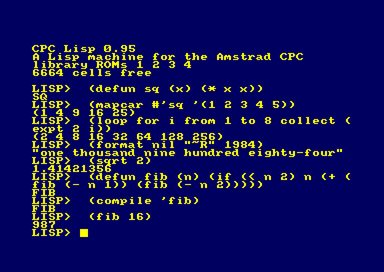
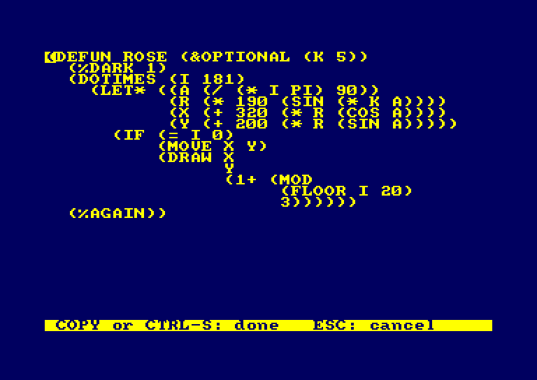
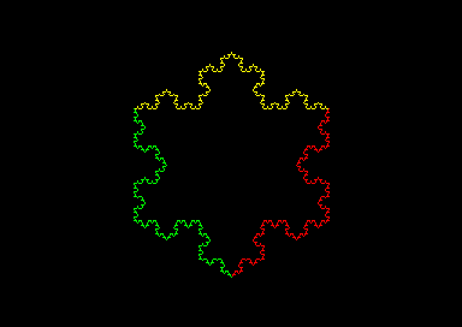
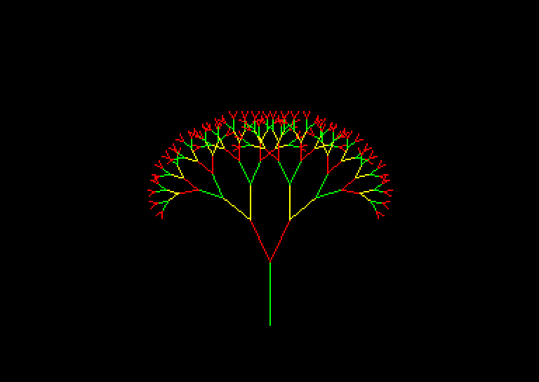
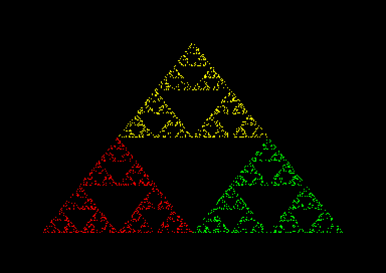
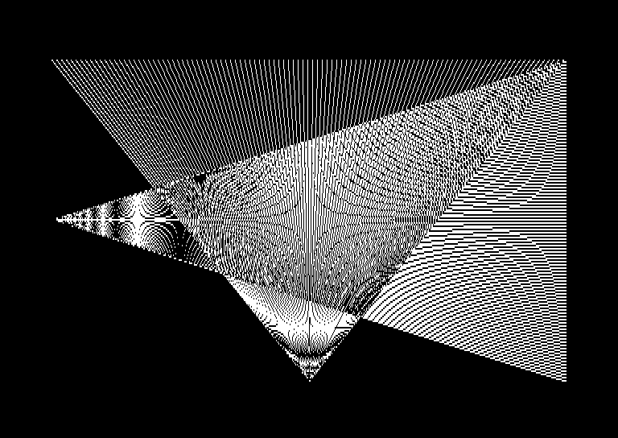
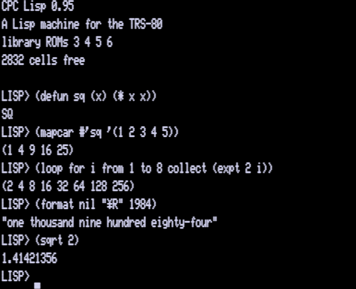
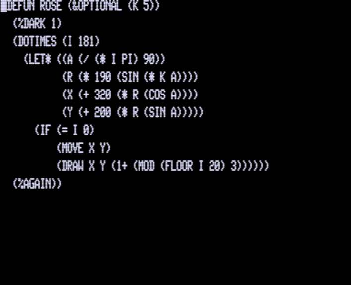

# CPC Lisp 0.95

*A Lisp machine for the Amstrad CPC*

ROMs that start a Lisp instead of BASIC. Common Lisp syntax, lexical closures, macros, a garbage collector
-- in 16 KB of Z80 assembly -- with graphics, sound, files, floats and
editors in four more ROMs, and a bytecode compiler in a fifth.

    CPC Lisp 0.95
    A Lisp machine for the Amstrad CPC
    library ROMs 4 5 6 3
    6402 cells free

    LISP> (defun fib (n) (if (< n 2) n (+ (fib (- n 1)) (fib (- n 2)))))
    FIB
    LISP> (fib 17)
    1597
    LISP> (compile 'fib)
    FIB
    LISP> (mapcar #'(lambda (x) (* x x)) '(1 2 3 4 5))
    (1 4 9 16 25)

## Machines

* **The Amstrad CPC** -- 464, 664 and 6128 -- is its home: six ROMs, on
  an expansion ROM board or the LambdaSpeak 4 card (below).
* **From disc, with no ROMs**: a CPC with a 512K RAM expansion --
  Revaldinho's, the DK'tronics, any that banks the DK'tronics way -- runs
  the same six images loaded into it; a plain 6128 runs five, without
  the compiler ([*From disc*](#from-disc), below).
* **The TRS-80 Model I and Model III with
  [X-MEM/80](https://github.com/lambdamikel/x-mem-80)** run it too, as a
  port: the same six images, under LDOS ([*On a
  TRS-80*](#on-a-trs-80), below).
* **More Z80 machines are on the way**, in this order: the ZX Spectrum
  128/+2/+3, the TRS-80 Model 4, MSX1, the TA alphatronic PC and the
  Sharp MZ-700. Everything a machine provides is behind one interface
  ([`mach/README.md`](mach/README.md)); the CPC's is `mach/cpc/`, the
  TRS-80's `mach/trs80/`.

## Videos

| | |
|---|---|
|  |  |
| [A Modern Lisp OS for the Amstrad CPC -- Common Lisp in ROM!](https://youtu.be/rrI9Di3qzVM) (11:32) | [CPC Lisp 0.9 Demos -- Turn your Amstrad CPC into a Lisp Machine!](https://youtu.be/qcSBfZ-axFA) (6:51) |

## Screenshots

From the emulators: MAME for the CPC, trs80gp for the TRS-80. The same
programs, the same Lisp.

**On the Amstrad CPC**

<table>
<tr><td align="center" valign="top">defun</code>, <code>mapcar</code>, <code>loop</code>, <code>format</code>, floats, the compiler"> The REPL: <code>defun</code>, <code>mapcar</code>, <code>loop</code>, <code>format</code>, floats, the compiler</td><td align="center" valign="top">(ed 'rose)</code>, pretty-printed"> The function editor: <code>(ed 'rose)</code>, pretty-printed</td><td align="center" valign="top">(rose)</code>: a rose curve, in floats"> <code>(rose)</code>: a rose curve, in floats</td><td align="center" valign="top">(koch 4)</code>: a Koch snowflake, turtle graphics"> <code>(koch 4)</code>: a Koch snowflake, turtle graphics</td></tr>
<tr><td align="center" valign="top">(tree)</code>: a recursive tree"> <code>(tree)</code>: a recursive tree</td><td align="center" valign="top">(shapes)</code>: discs and boxes in 16 colours"> <code>(shapes)</code>: discs and boxes in 16 colours</td><td align="center" valign="top">(sierpinski)</code>: the chaos game"> <code>(sierpinski)</code>: the chaos game</td><td align="center" valign="top">(moire)</code>: lines drawn with XOR"> <code>(moire)</code>: lines drawn with XOR</td></tr>
</table>

**On the TRS-80 Model I with X-MEM/80**

<table>
<tr><td align="center" valign="top"> The REPL on a TRS-80 Model I with X-MEM/80</td><td align="center" valign="top"> The function editor, 64 by 16</td><td align="center" valign="top">(shapes)</code> in the 2 x 3 blocks"> <code>(shapes)</code> in the 2 x 3 blocks</td></tr>
<tr><td align="center" valign="top">(koch 4)</code>"> <code>(koch 4)</code></td><td align="center" valign="top">(tree)</code>"> <code>(tree)</code></td><td align="center" valign="top">(sierpinski)</code>"> <code>(sierpinski)</code></td></tr>
</table>

## What it has

The **core** ROM boots to `LISP>`: integers and floats, symbols, conses,
strings, characters, vectors, closures, special variables, `defmacro` and
backquote, `block`/`catch`/`unwind-protect`, `labels`/`flet`, `setf`, all
of CL's lambda lists, multiple values, catchable errors, tail calls, ESC
to break, a mark-and-sweep garbage collector.

The **library** comes in five more ROMs:

| ROM | file | what |
|---|---|---|
| library 1 | LISPLIB.ROM | the screen, graphics (circles, flood fill, XOR, turtle graphics), sound, keys and joystick; strings and characters; the printers and readers with CL's streams; files through the disc ROM, and a RAM disc on a 6128 (in X-MEM/80 on a TRS-80); the line editor and a full-screen function editor |
| library 2 | LISPLIB2.ROM | lazy loading (programs bigger than memory: functions read from the file when first called, dropped again when the cells run out), floats and the maths functions through the firmware, `format` with all its directives, `sort`, the sequence functions with all their keywords, hash tables, structures, `coerce`, speech, PlayCity and MIDI out on the LambdaSpeak card (Talker/80 and MIDI/80 on a TRS-80), `(basic)` and `\|BOOTLISP` |
| library 3 | LISPLIB3.ROM | about eighty CL functions and macros written in Lisp (`reduce`, `map`, `defstruct`, `typep`, `handler-case`, `with-open-file`...), read from ROM the first time each is used |
| demo | LISPDEMO.ROM | `loop` (the extended one too), string streams, far arrays on the RAM disc, and demo programs: `(demo)` lists them |
| VM | LISPVM.ROM | the bytecode machine, and the compiler: `compile`, `compile-file`, `disassemble` |

It runs on a real 464, with the 1.0 and the 1.1 firmware, and in MAME on
the 464 and the 6128; from disc on a 464 and a 6128 with 512K more and
on a plain 6128, in MAME; and on a real TRS-80 Model I and Model III with
X-MEM/80, and in trs80gp. On a TRS-80 the same functions are there but
for the CPC's own -- colours and windows, user-defined characters, the
joystick, `peek`/`poke`, the sound queues, PlayCity, `(basic)`: the
[reference](docs/reference.md) marks them **CPC only**, and
[*On a TRS-80*](#on-a-trs-80) below says what differs.

## Installing the ROMs

**Ready-made images are in [`roms/`](roms/)** -- `LISP.ROM` (the core),
`LISPLIB.ROM`, `LISPLIB2.ROM`, `LISPLIB3.ROM`, `LISPDEMO.ROM` and
`LISPVM.ROM`, 16 KB each; [`roms/README.md`](roms/README.md) says what
each is. Or build your own: `tools/build.sh` makes them in `build/`.
**All six must come from the same build**: the core finds the others by
a signature with the build number, and leaves out any from another build
(they call each other by address).

Any ROM box or ROM board takes them, or the LambdaSpeak card (below).

**ROM numbers.**

* **The core at ROM 0**, with ROMDIS asserted, replaces BASIC: the CPC
  starts in Lisp. (BASIC's ROM obeys ROMDIS on the 464, 664 and 6128.)
  At any other free number, the CPC starts in BASIC, and `|LISP` is to
  start Lisp (built in, not tried yet).
* **The other five at any free numbers from 1 to 6, in any order.** Not
  7: that is the disc ROM (AMSDOS, Parados). The core searches ROMs 1-15
  for them, but the 464's firmware only knows ROMs 0-7.
* **Only the core is needed.** Leave out any of the others and their
  functions are simply not there; the banner lists the library ROMs it
  found (the VM ROM is not listed).
* Like any expansion ROM, each lowers the free memory a little.

**On the LambdaSpeak card** --
[LambdaSpeak 4, aka LambdaSpeak AI](https://github.com/lambdamikel/lambdaspeak4)
([Hackaday](https://hackaday.io/project/206813-lambdaspeak-4-aka-lambdaspeak-ai)),
which serves eight ROMs from flash, uploaded over USB, and does the
speech, PlayCity and MIDI Lisp's `say`, `pc-tone` and `midi-note`
use. CPC Lisp was
developed on it; its own Parados and LS AI ROMs keep their slots:

| slot | ROM number | image |
|---|---|---|
| 4 | 0 | LISP.ROM -- the CPC boots into it |
| 5 | 4 | LISPLIB.ROM |
| 0 | 5 | LISPLIB2.ROM |
| 7 | 6 | LISPLIB3.ROM |
| 3 | 3 | LISPDEMO.ROM |
| 1 | 1 | LISPVM.ROM |
| 2 | 7 | Parados (the card's) -- not touched |
| 6 | 2 | LS AI (the card's) -- not touched |

Upload the images with the card's ROM loader, with the CPC **switched
off**. From this repository, `python3 tools/card.py lisp` uploads the six
in `build/` (it checks that the CPC is off first, and refuses slots 2
and 6);
`tools/card.py slots` lists the slots. `card.py` drives the uploader of
the LambdaSpeak 4 tools (`~/git/lambdaspeak4/tools`).

**BASIC and back**, with no PC: `(basic)` at `LISP>` makes the core's
slot silent and resets -- the CPC comes up in BASIC; there, `|BOOTLISP`
makes it ROM 0 again and resets into Lisp. (Both take the slot if it is
not 4: `(basic 3)`, `|BOOTLISP,3`. Everything in RAM goes: save first.)
From the PC, with the CPC off, `tools/card.py basic` and
`tools/card.py number 4 0` do the same.

**On a ROM board or in EPROMs**: one 16 KB ROM (27128) each. The core at 0
needs a board that can assert ROMDIS, or another number and `|LISP`. On a
6128 or 664 the internal AMSDOS is ROM 7 and ignores ROMDIS: never put
anything at 7 there.

## Building and testing

Needs rasm, Python 3 and MAME with the CPC ROMs (paths in `tools/build.sh`).

    tools/build.sh                 # the six ROMs in build/, and MAME romsets
                                   # with the core at ROM 0
    tools/mame.sh                  # a MAME window to play in (-m 6128 for a 6128)
    tools/run.sh file.lsp          # type a file at it in MAME, print the transcript
    tools/test.sh                  # the regression tests in test/ (-m 6128 for a 6128)

What depends on the CPC is in `mach/cpc/`; the rest is portable Z80
code. [`mach/README.md`](mach/README.md) is the interface between them,
for a port to another Z80 machine (`MACH=<machine> tools/build.sh`).

The build runs the compiler on itself first (`tools/bootstrap.py`, see
[the design](docs/design.md#the-bootstrap)).

**Typing a tilde** (`format`'s `~A`, `~%`...): the CPC has no `~` key --
it is **CTRL + 2** (in MAME, Right Alt + 2).

## From disc

No ROM board? CPC Lisp loads from disc too, on a 464, 664 or 6128 with
AMSDOS or Parados -- `RUN"LISP` -- in two versions:

**With a 512K RAM expansion** that banks the DK'tronics way --
Revaldinho's universal RAM cards, the DK'tronics 512K, an X-MEM's RAM --
the six images run in the expansion: all of CPC Lisp, the compiler too,
and a RAM disc `M:` of 415 KB in its free blocks -- which also holds
far arrays (`make-far-array`, `far-ref`) and programs loaded with
`(load "m:big" :lazy t)`, each function read in when first called.

    CPC Lisp 0.95
    A Lisp machine for the Amstrad CPC, 512K
    library ROMs 1 2 3 4
    6054 cells free

**On a plain 6128** (or a CPC with 64 KB more), five images fill the 128
KB: everything but the compiler, without a RAM disc, and with about 2400
cells.

    CPC Lisp 0.95
    A Lisp machine for the Amstrad CPC, 128K
    library ROMs 1 2 3 4
    2430 cells free

**The discs are ready in [`discs/`](discs/)** -- `cpclisp512.dsk` and
`cpclisp6128.dsk`, and a test disc for the ROMs' use of a RAM expansion;
each has `HWTEST.LSP`, a test of the real machine (`(load "hwtest")`,
`(hwtest)`). Or build them: `MACH=cpc512 tools/build.sh` makes
`build/cpc512/cpclisp512.dsk`, `MACH=cpc6128 tools/build.sh`
`build/cpc6128/cpclisp6128.dsk`. `(basic)` goes back to BASIC, and
`RUN"LISP` starts Lisp again (with the 512K, the RAM disc's files are
still there). [`mach/cpc512/README.md`](mach/cpc512/README.md) and
[`mach/cpc6128/README.md`](mach/cpc6128/README.md) have how they work.
Both run on a real 464 with Revaldinho's 512K card -- in its DIP
configuration 4 (2026-11-12): [`discs/README.md`](discs/README.md).

## On a TRS-80

The same Lisp -- the same six images, built from the same sources --
runs on a **TRS-80 Model I or Model III** with Michael Wessel's and Mark
Pruden's [X-MEM/80](https://github.com/lambdamikel/x-mem-80), 512 KB in
16 KB pages: the images run unchanged in its window at &C000. What is the
TRS-80's -- the screen, the keys, graphics in the 2 x 3 blocks, sound on
the cassette port, floats through the Level II ROM, files through LDOS,
a RAM disc in X-MEM/80's spare pages, speech through Talker/80, MIDI
through MIDI/80 -- is in `mach/trs80/`.

    CPC Lisp 0.95
    A Lisp machine for the TRS-80
    library ROMs 3 4 5 6
    2832 cells free

**What it needs**: a Model I or III; X-MEM/80 with its jumper in X-MEM
mode (not SuperMem); a disc drive, real or emulated. Talker/80 for
speech, MIDI/80 for MIDI and a printer are optional.

**Talker/80 on a Model I: reprogram its U1 first.** The Model I
Talker/80's address decoder (U1, a GAL22V10) answers ports 64-67 as
well as 11 -- the VS-100's ports -- and X-MEM/80's page registers are 65
and 66: every page switch lands in Talker/80 as text, and it falls
silent. Program U1 with
[`Talker80-decoder-xmem.jed`](https://github.com/lambdamikel/Talker-80/blob/master/src/gal22v10/m1/Talker80-decoder-xmem.jed) from the Talker/80 repository
([why](https://github.com/lambdamikel/Talker-80#the-model-1-address-decoder-and-x-mem80)); the VS-100 and TRS Voice Synthesizer modes are unchanged.
The Model III Talker/80 needs nothing.

**The disc**: ready to boot with each
[release](https://github.com/lambdamikel/cpc-lisp-machine-os/releases) --
`cpc-lisp-0.95-trs80-model1` and `-model3`, as `.dsk` for emulators and
`.hfe` for a Gotek. Or build it: `MACH=trs80 tools/build.sh` (rasm and Python 3, as for the
CPC, above) makes `build/trs80/lisp-a.dsk` for a Model I -- LDOS 5.3.1,
single density, JV1, with `LISP/CMD` and the seven images on it,
compressed -- and `build/trs80/lisp-m3.dsk` for a Model III -- LDOS
5.1.4, double density, JV3.

**Starting**: boot that disc, give LDOS the date (and on a Model I the
time), and at `LDOS Ready` type

    LISP

It loads the images into X-MEM/80's pages and starts; without X-MEM/80
in its X-MEM mode it says so and goes back to LDOS. `(quit)` goes back to
LDOS; the RAM disc `M:` keeps its files.

**In an emulator**: [trs80gp](http://48k.ca/trs80gp.html) has X-MEM/80
for the Model I:

    trs80gp -m1 -mem xmem80 -d0 build/trs80/lisp-a.dsk

(`tools/trs80/play.sh` does that, and types the date, the time and
`LISP` for you.)

**What is different**: the screen is 64 by 16 and the graphics 128 by
48 blocks, in one colour; sound is one voice; BREAK is ESC; about 2800
cells instead of 6400. The keys a TRS-80 has not got: **SHIFT
down-arrow, then `-`** is `~`, then `/` is `\`, `8` `9` are `[` `]`...
[`mach/trs80/README.md`](mach/trs80/README.md) has it all, and
[`mach/trs80/hardware-test.txt`](mach/trs80/hardware-test.txt) what to
try on a real one. It was made in trs80gp, and runs on a real Model I
and Model III with X-MEM/80 -- in its 16 KB mode -- Talker/80 and
MIDI/80 (2026-11-12); the discs, with a test of the machine, are in
[`discs/`](discs/).

## Documents

* [`roms/README.md`](roms/README.md): the ready-made ROM images -- what
  each is, and how to install them
* [`discs/README.md`](discs/README.md): CPC Lisp from disc (512K, plain
  6128) and the test discs for the real machine
* [`docs/tutorial.md`](docs/tutorial.md): a tour at the keyboard -- the
  language, then the screen, graphics, the turtle, keys, sound, speech,
  files and the compiler
* [`docs/reference.md`](docs/reference.md): the reference manual -- the
  REPL, the editors, the syntax, and every function, form and macro
* [`docs/design.md`](docs/design.md): how it is made -- the memory, the
  objects, the evaluator, the ROMs, the bytecode machine and the compiler
* [`docs/internals.md`](docs/internals.md): the internals in detail --
  the `%` names, lexical closures, tail calls, the speed work, and how
  the compiler was bootstrapped
* [`docs/checklist.md`](docs/checklist.md): everything implemented, by
  ROM, and what is still open
* [`mach/README.md`](mach/README.md): the machine layer -- the interface
  a port to another Z80 machine provides
* [`mach/cpc512/README.md`](mach/cpc512/README.md): CPC Lisp from disc,
  on a CPC with a 512K expansion
* [`mach/cpc6128/README.md`](mach/cpc6128/README.md): CPC Lisp from disc,
  on a plain 6128
* [`mach/trs80/README.md`](mach/trs80/README.md): the TRS-80 Model I and
  III with X-MEM/80 -- building, the discs, the keys, what works
* [`docs/hardware-test.txt`](docs/hardware-test.txt): what to type on a
  real CPC, and what it should answer
* `CLAUDE.md`: working notes -- what was learned about the CPC, MAME and
  the card along the way

## Licence

CPC Lisp is free software under the
[GNU General Public License, version 3](LICENSE) (GPL-3.0), like
LambdaSpeak 4: use it, change it, pass it on -- and whoever passes on a
changed version, ROM images included, passes on its source with it.
Copyright (C) 2026 Michael Wessel.

**Your programs are yours.** As an additional permission under section 7
of the GPL, programs written in CPC Lisp, and the files `save` and
`compile-file` make of them, may be distributed on any terms their
authors choose, even though they run on these ROMs and use their
functions.
