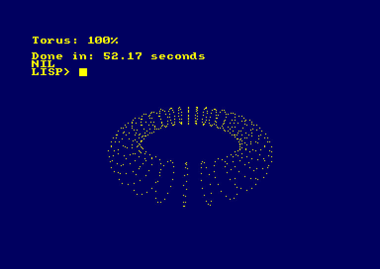
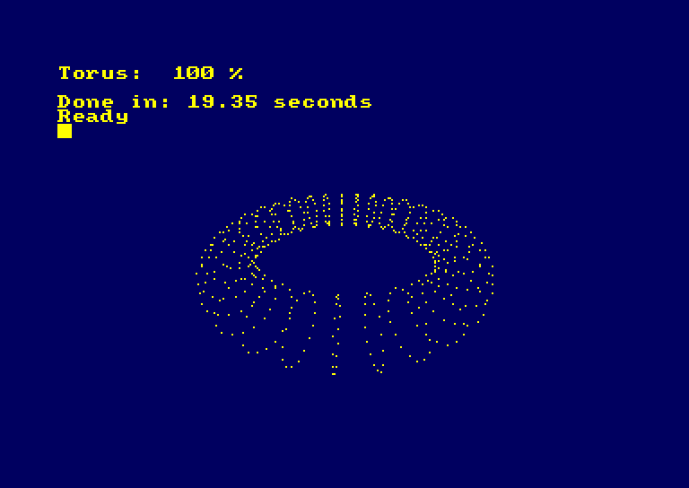
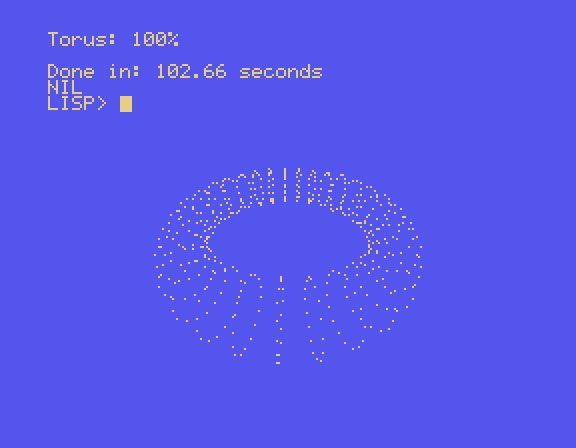
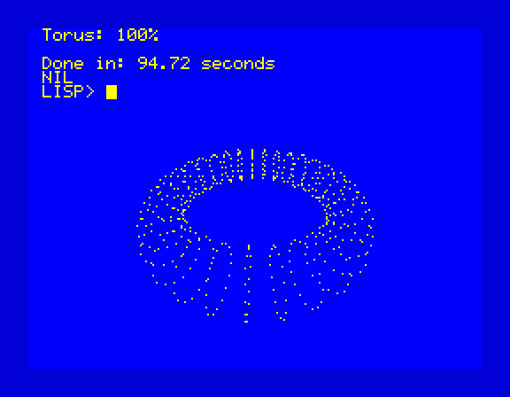

# CPC Lisp 0.98 -- benchmarks, and some history

*A Lisp machine for the Amstrad CPC*

How fast is CPC Lisp, against the Lisps of its own time on the same kind
of machine, against the big machines of the 1980s, and against a Lisp of
today? Measured on 2026-11-17, at Mike's question: "if you compare CPC
Lisp with UOLisp for the TRS-80, which also had a compiler, who wins?"
And how fast is it on each machine it runs on, and against BASIC?
Measured on 2026-11-22: *The ports compared*, *Against BASIC*.

## The benchmarks

The same three small programs everywhere, written in Common Lisp and in
each other Lisp's own dialect (`tools/bench/`):

* **`(fib 20)`**: the doubly recursive Fibonacci, 21,891 calls. Small
  integers and function calls, nothing else.
* **`(tak 18 12 6)`**: Ikuo Takeuchi's function, the first of Richard
  Gabriel's benchmarks (*Performance and Evaluation of Lisp Systems*, MIT
  Press, 1985). It makes 63,609 calls and does little else.
* **`deriv` × 100**: Gabriel's symbolic derivative of `(+ (* 3 x x) (* a
  x x) (* b x) 5)`, a hundred times. It builds lists, so it measures
  `cons`, `mapcar` and the garbage collector. Gabriel ran it 5,000 times,
  so multiply by 50 to compare with his tables.

Each runs interpreted, then compiled.

## In a nutshell

Each Lisp's time divided by CPC Lisp's on the same machine: above 1,
CPC Lisp is faster; below 1, the other Lisp is.

**Interpreted**, against CPC Lisp's interpreter:

| Lisp (year), machine | `fib` | `tak` | `deriv` |
|---|---|---|---|
| muLISP-80 (1980), CPC 6128 | 0.94 | 0.69 | 0.96 |
| muLISP-80 2.15 (1982), CPC 6128 | 0.97 | 0.70 | 0.94 |
| LinguaSoft/HiSoft Lisp (1986), CPC 6128 | 2.5 | 2.1 | 2.8 |
| UOLisp (1982), TRS-80 Model I | 11.8 | 10.4 | 11.0 |
| LISP/80 (1980), CPC 6128 | 18 | fails | 17 |
| XLisp 1.1 (1985), CPC 6128 | 65 | wrong answer | crashes |

**Compiled**, against CPC Lisp's compiler (the CP/M Lisps have none):

| Lisp (year), machine | `fib` | `tak` | `deriv` |
|---|---|---|---|
| UOLisp (1982), `!*OPT`, TRS-80 Model I | 0.66 | 1.23 | 1.45 |
| UOLisp, `!*FAST`, TRS-80 Model I | 0.45 | 0.55 | crashes |

* **Only muLISP's interpreter is faster than CPC Lisp's**, by 3-6% on
  `fib` and `deriv` and 1.45 times on `tak`. The others are 2-65 times
  slower; two of them cannot finish `tak`.
* **None of the CPC's CP/M Lisps has a compiler.** CPC Lisp's compiled
  code is 1.5-4 times faster than muLISP's interpreter, and 4.6-12 times
  faster than HiSoft's.
* **Against UOLisp's native code on the TRS-80 it is a draw** at
  UOLisp's safe setting. UOLisp's `!*FAST` is about twice as fast, but
  it crashes on `deriv`, and UOLisp's 13-bit integers give the wrong
  `(fib 20)`.
* **SBCL on a 2019 PC** is 3,000-4,900 times faster than CPC Lisp
  interpreted, and 154,000-267,000 times faster compiled.
* **Across the ports**, with the CPC 464 at 1.0, the Lisp itself runs
  at 0.96-1.00 on the other CPCs (the plain 6128's disc version 0.80),
  0.81 on the MSX, 0.71 on the Spectrum, 0.69 on the TRS-80 Model 4 and
  0.48 on the Model I.
* **Against Locomotive BASIC, on floats, BASIC wins** by 2.7 times: a
  torus of dots, the same program in both.

## Who wins on the TRS-80

The machine is a TRS-80 Model I (1977; a Z80 at 1.77 MHz), emulated by
trs80gp. **UOLisp** is Jed Marti's UO-LISP V1.5b of June 3, 1982,
sold by Northwest Computer Algorithms. It is a Standard LISP, the dialect
of the REDUCE computer algebra system, with an optimizing compiler to
native Z80 code. It runs on a 48 KB Model I under TRSDOS 2.3. Mike
imaged its disc, and the Computer History Museum's Software Preservation
Group keeps the image. **CPC Lisp** is the same Lisp as
on the CPC, under LDOS. It needs Mike's X-MEM/80, since its six 16 KB
images live in the card's pages. Its compiler makes bytecode for a VM
written in Z80 assembly.

**Interpreted**

| Model I, 1.77 MHz | `(fib 20)` | `(tak 18 12 6)` | `deriv` × 100 |
|---|---|---|---|
| CPC Lisp | **121 s** | **578 s** | **17.5 s** |
| UOLisp | 1,433 s | 6,007 s | 193 s |

**Compiled**

| Model I, 1.77 MHz | `(fib 20)` | `(tak 18 12 6)` | `deriv` × 100 |
|---|---|---|---|
| CPC Lisp (bytecode) | 32.5 s | **87 s** | **9.2 s** |
| UOLisp (native, `!*OPT`) | **21.3 s** | 107 s | 13.3 s |
| UOLisp, `!*OPT` `!*FLINK` | 21.3 s | 107 s | 13.3 s |
| UOLisp, `!*OPT` `!*FLINK` `!*FAST` | 14.6 s | 48 s | crashes to DOS |

In bold, the winner at each Lisp's safe settings.

* **Interpreted, CPC Lisp wins by 10-12 times** on all three.
* **Compiled, at UOLisp's safe settings, it is a draw.** UOLisp's
  native code wins `fib` by 1.5 times. CPC Lisp's bytecode wins `tak`
  by 1.2 times and `deriv` by 1.45 times.
* **UOLisp's `!*FAST` level** wins `fib` by 2.2 times and `tak` by 1.8
  times, but it took `deriv` down with it, back to `DOS READY`.
* **UOLisp's `(fib 20)` is -1427, not 6765.** Its integers are 13 bits
  (-4096 to 4095) and wrap silently. CPC Lisp's are 15 bits; past them
  it goes on in floats.
* UOLisp needs nothing but the 48 KB Model I. CPC Lisp needs the
  X-MEM/80, and in return gets its closures, `format`, `loop`,
  structures, editors and graphics.

## The same Lisp on a CPC, and SBCL

The CPC is a 464 (1984; Z80, 4 MHz), the PC a 2019 Core i3-9100 at 3.6
GHz with SBCL 2.2.9.

**Interpreted**

| | `(fib 20)` | `(tak 18 12 6)` | `deriv` × 100 |
|---|---|---|---|
| CPC Lisp, CPC 464 | 58 s | 265 s | 7.9 s |
| SBCL, PC (`sb-eval`) | 19 ms | 54 ms | 1.8 ms |

**Compiled**

| | `(fib 20)` | `(tak 18 12 6)` | `deriv` × 100 |
|---|---|---|---|
| CPC Lisp, CPC 464 | 16.9 s | 46 s | 4.8 s |
| SBCL, PC | 0.11 ms | 0.26 ms | 0.018 ms |

* The CPC runs the same Lisp about twice as fast as the Model I. Its
  Z80 runs at 4 MHz, about 3.3 MHz once the video's wait states are
  counted.
* SBCL is CMU Common Lisp's descendant (Carnegie Mellon, the 1980s),
  forked in 1999. Compiled, it is 150,000-270,000 times faster than
  compiled CPC Lisp on a 464. Even its interpreter beats the 464's
  compiled code by a factor of 1,000-3,000.

## The CPC's own Lisps of the day

The CPC's Lisps of the 1980s ran under CP/M. Mike's 2018 thread on the
CPCWiki forum, "Lisp on the CPC", dug up the ones that work, and he put
two discs together from several CP/M sources. With two of CPC-Power's,
that makes five Lisps on four discs, all in [`vintage/`](../vintage/):

* **muLISP-80** (The Soft Warehouse, Honolulu, 1980; licensed by
  Microsoft), the Lisp of the muMATH computer algebra system. There are
  two versions: the 8080 version of 10/06/80 on Mike's disc, and 2.15
  (03/01/82), which HiSoft sold in 1987 as its "LISP Interpreter"
  (£39.95). CPC-Power's copy of that is damaged. Its library does not
  load, even started as `lisp baselisp`, so there is no `DEFUN`,
  `MAPCAR` or `PROG`. Its multiplication is broken: `(TIMES 12 12)` is
  180. The benchmarks do not multiply, and its `fib` and `tak` answers
  are right.
* **LinguaSoft Lisp 1.57B** (Ofer and Shelly Ben-Ami, 1986-88). This is
  HiSoft's real Lisp, for the 6128 and the PCW, and comes with HLE, a
  full-screen editor.
* **LISP/80 1.1** (T. W. Yonkman, The Software Toolworks, 1980).
* **XLisp 1.1** (David Betz, 1985), written in C. AutoCAD's AutoLISP
  grew out of an early XLisp.

All five ran on MAME's 6128 (Z80, 4 MHz).

**Interpreted**

| CPC 6128 | `(fib 20)` | `(tak 18 12 6)` | `deriv` × 100 |
|---|---|---|---|
| muLISP-80 (1980) | **55.2 s** | **183 s** | 7.6 s |
| muLISP-80 2.15 (1982) | 56.8 s | 186 s | **7.4 s** |
| CPC Lisp | 58.6 s | 266 s | 7.9 s |
| LinguaSoft/HiSoft Lisp 1.57B (1986) | 146 s | 554 s | 22.1 s |
| LISP/80 1.1 (1980) | 1,041 s | fails | 132 s |
| XLisp 1.1 (1985) | 3,780 s | wrong: 12 | crashes |

**Compiled**: none of the others has a compiler.

| CPC 6128 | `(fib 20)` | `(tak 18 12 6)` | `deriv` × 100 |
|---|---|---|---|
| CPC Lisp | 16.9 s | 46 s | 4.8 s |

* **muLISP-80 and CPC Lisp's interpreter are level.** muLISP is 3-7%
  faster on `fib` and `deriv`, and 1.45 times on `tak`. The 1980 8080
  version is as fast as 2.15. It was the fast microcomputer Lisp of its
  day, built for computer algebra.
* **HiSoft's Lisp, the one sold for the 6128, is 2-3 times slower**
  than either.
* **LISP/80 and XLisp are another world**: 19 and 68 times slower than
  muLISP on `fib`. XLisp, written in C, takes a cell for every integer
  it computes.
* **Neither finishes `tak`.** LISP/80 seems to lose stack as it goes:
  `tak` stops with ERROR 18 after 54 s with the default stack, and
  after 15 minutes with a 20 KB one (`LISP_80 S=20000`). A `PROG` loop
  of `deriv` stops with ERROR 13 after some 36 rounds, so the table's
  `deriv` loops by recursion. XLisp corrupts its heap on a long run:
  `(tak 18 12 6)` answered 12 after 50 minutes, though `(tak 12 8 4)`
  and smaller come out right. Its `deriv` stopped after 222 s with
  "bad node type (172) found during left scan", from its garbage
  collector, and fell back to CP/M's `A>`.
* **Only muLISP counts past 16 bits**: its `(TIMES 300 300)` is 90000.
  LinguaSoft, LISP/80 and XLisp wrap: 200 times 200 is -25536.
  LinguaSoft's `*` at least reports an overflow.
* **With its compiler CPC Lisp is 3.3, 4 and 1.5 times faster than
  muLISP.**

## Defining a function, in each dialect

Each of these Lisps starts at a bare prompt, and for most of them it is
not obvious how to make a function of your own. The manuals, where they
survive, are scans (vintage/README.md says where they are). Here is each one's way, as it answered in the emulator: a
function defined, called, and the way back out. The discs boot CP/M Plus
with `|CPM`.

**CPC Lisp** (and SBCL: this is Common Lisp)

    LISP> (defun square (n) (* n n))
    SQUARE
    LISP> (square 12)
    144
    LISP> (compile 'square)
    SQUARE

**muLISP-80**: `MULISP` on vintage/cpc/mulisp-lisp80.dsk (`LISP` on
the 2.15 disc). A function is a `LAMBDA` put on its name with `PUTD`:

    $ (PUTD (QUOTE SQUARE) (QUOTE (LAMBDA (N) (TIMES N N))))
    (LAMBDA (N) (TIMES N N))
    $ (SQUARE 12)
    144
    $ (PUTD (QUOTE FACT) (QUOTE (LAMBDA (N) ((ZEROP N) 1)
      (TIMES N (FACT (DIFFERENCE N 1))))))
    (LAMBDA (N) ((ZEROP N) 1) (TIMES N (FACT (DIFFERENCE N 1))))
    $ (FACT 7)
    5040
    $ (SYSTEM)
    A>

* A function's body is an implicit `COND`. An element whose head is a
  list is a test: if it holds, its other elements are evaluated and the
  function returns the last one, as `((ZEROP N) 1)` above.
* There is no `'`: `(CAR '(A B))` is `'`. Write `QUOTE`.
* A call of an undefined function comes back as it was typed:
  `(ADD1 5)` answers `(ADD1 5)`.
* `(RDS (QUOTE UTILITY) (QUOTE LIB))` loads the 1980 version's library.
  Then there are `DEFUN`, `(DEFUN SQUARE (LAMBDA (N) (TIMES N N)))`, and
  `MAPCAR`, `ADD1`, `APPEND`...

**LinguaSoft/HiSoft Lisp**: `LISP6128` on vintage/cpc/hisoft-lisp.dsk.
The prompt is `§`:

    § (DEFUN SQUARE (N) (TIMES N N))
    Value is...
    SQUARE
    § (SQUARE 12)
    Value is...
    144
    § (EXIT)
    A>

* `EQ` is false for numbers: `(EQ 300 300)` is NIL. Write `EQUAL`, or
  `(LESSP N 1)` for `ZEROP`, which is not there either.
* `MAPCAR` takes the list first: `(MAPCAR '((1) (2)) 'CAR)` is `(1 2)`.
* `'-` right before a `)` hangs the reader: write `'- )`.

**LISP/80**: `LISP_80` on vintage/cpc/mulisp-lisp80.dsk (`LISP_80
S=20000` for a bigger stack). The number in the prompt counts the open
parentheses, and an answer follows a `>`:

    0>(DEFPROP SQUARE (LAMBDA (N) (TIMES N N)) EXPR)
    >(LAMBDA(N)(TIMES N N))
    0>(SQUARE 12)
    >144

CTRL-C goes back to `A>`.

* `DEFPROP` puts the `LAMBDA` on the name's property list as its EXPR.
  The manual's `DEFINE ((SQUARE (N) ...))` makes a broken definition in
  version 1.1, and ERROR 1 when it is called.
* There is no `'`: write `QUOTE`. There is no `SUB1` or `ZEROP`.
* `MAPCAR` takes the function first.

**XLisp 1.1**: vintage/cpc/xlisp11.dsk starts it by itself:

    > (defun square (n) (* n n))
    square
    > (square 12)
    144
    > (exit)
    A>

* Its core has no `if`, `not`, `mapcar` or `caddr`. Write `cond`,
  `null`, recursion and `car`/`cdr`.

**UOLisp** (TRS-80 Model I): `LISP48` at `TRSDOS READY`, with the
prompt `*`. Standard LISP defines with `DE`, `(DE FIB (N) ...)`. After
`(FLOAD "COMP ")` (the space is needed) and `(SETQ !*COMP T)`, `DE`
compiles to Z80 code. There, add with `PLUS2`: `PLUS` is an FEXPR, which
cannot see a compiled function's variables.

The benchmark's `fib`, in each:

    ; CPC Lisp, SBCL
    (defun fib (n) (if (< n 2) n (+ (fib (- n 1)) (fib (- n 2)))))
    ; UOLisp
    (DE FIB (N) (COND ((LESSP N 2) N) (T (PLUS2 (FIB (SUB1 N)) (FIB (DIFFERENCE N 2))))))
    ; muLISP-80
    (PUTD (QUOTE FIB) (QUOTE (LAMBDA (N) (COND ((LESSP N 2) N)
      (T (PLUS (FIB (DIFFERENCE N 1)) (FIB (DIFFERENCE N 2))))))))
    ; LinguaSoft/HiSoft Lisp
    (DEFUN FIB (N) (COND ((LESSP N 2) N) (T (PLUS (FIB (DIFFERENCE N 1)) (FIB (DIFFERENCE N 2))))))
    ; LISP/80
    (DEFPROP FIB (LAMBDA (N) (COND ((LESSP N 2) N)
      (T (PLUS (FIB (DIFFERENCE N 1)) (FIB (DIFFERENCE N 2)))))) EXPR)
    ; XLisp 1.1
    (defun fib (n) (cond ((< n 2) n) (t (+ (fib (- n 1)) (fib (- n 2))))))

`tak` and `deriv` in each are in `tools/bench/`: `cpc.lsp`,
`uolisp-*.txt`, `mulisp.txt`, `linguasoft.txt`, `lisp80.txt`,
`xlisp.txt`. `deriv` maps with `MAPCAR` where the Lisp has it, and with
two small recursive functions where it has not (muLISP, XLisp).

## The utter horrors of the 1980s: alien toy Lisp dialects on microcomputers

Getting each of them to define and run three small functions took from
a few minutes to an afternoon. A blunt verdict, from that:

**muLISP-80 is the only one you could have worked in.** It is fast, as
fast as CPC Lisp's interpreter, from a 9.5 KB program, and its
integers do not wrap. But it fights you on every line. There is no `'`,
so every constant is `(QUOTE ...)`, and a function is `(PUTD (QUOTE F)
(QUOTE (LAMBDA ...)))` until you load the library that brings `DEFUN`.
Worst of all, a misspelt function is no error: `(ADD1 5)` without the
library answers `(ADD1 5)`, and a typo deep in a program quietly hands
its own call back up as data. The copy HiSoft sold in 1987 cannot
multiply.

**LinguaSoft/HiSoft Lisp has the friendliest face on a slow engine.**
It reads like a real Lisp, with `DEFUN`, `'`, and errors in English that
name the culprit ("Expression in function position not a function --
Faulty argument:- ((1) (2))"). It comes with a full-screen editor. Then
it trips you:

* `EQ` is false for two equal numbers, so the textbook `(EQ N 0)`
  recurses until "Variable binding space exhausted".
* `'-` before a `)` hangs the reader without a word.
* `TIMES` wraps at 16 bits in silence, while `*` reports the overflow.
* It drops keys typed while it reads a line.

It is 2-3 times slower than muLISP, which was six years older, and no
manual for it has turned up.

**LISP/80 is a teaching toy that cannot finish its homework.** Its
manual is a friendly tutorial, but the tutorial's way to define a
function, `DEFINE`, makes a broken definition in version 1.1. The way
that works, `DEFPROP`, takes guessing. Errors are bare numbers, "ERROR
14", with no table to look them up in. It is 19 times slower than
muLISP, and it cannot run `(tak 18 12 6)` or a `PROG` loop of 100
rounds: it loses stack as it goes, and stops with ERROR 18 or ERROR 13.

**XLisp 1.1 is the future, at an hour per `fib`.** It is the only one
that looks modern: lower case, `defun`, `'`, `(exit)`. Its descendants,
XLISP-PLUS and AutoCAD's AutoLISP, lived on. On a 4 MHz Z80 it is
unusable: `(fib 20)` takes an hour, 68 times muLISP. It also cannot be
trusted with a long run. After 50 minutes of `(tak 18 12 6)` it answers
12 instead of 7, and `deriv` ends in its garbage collector's "bad node
type (172) found during left scan" and a drop back to CP/M. Its core
has no `if`, `not`, `mapcar` or `caddr` ("error: null function"), and
its integers wrap at 16 bits.

**UOLisp has a real compiler and arithmetic you cannot trust.** Native
Z80 code from a 48 KB TRS-80 in 1982 was ahead of its time. But its
13-bit integers wrap in silence, and `(fib 20)` answers -1427 with a
straight face. Its interpreter is 10-12 times slower than CPC Lisp's.
`(FLOAD "COMP")` fails without a trailing space, compiled code cannot
use `PLUS` ("NOT GLOBAL N"), and its fastest setting took the machine
back to DOS.

**What they share.** They give text only: no graphics or sound. They
offer little help when something goes wrong, and two have no `'`.
Four of them wrap their integers, mostly without a word. For a CPC
owner in 1987 it was muLISP, if you could find a copy that worked, or
HiSoft's, if you had patience.

**And CPC Lisp.** The same pitfalls, typed into the ROM version on a
464:

    LISP> (defun square (n) (* n n))
    SQUARE
    LISP> (add1 5)
    Error: undefined function ADD1
    LISP> (eq 300 300)
    T
    LISP> (* 300 300)
    90000.0
    LISP> (list '- '* '/)
    (- * /)
    LISP> (mapcar #'square '(1 2 3))
    (1 4 9)
    LISP> (car 5)
    Error: not a list: 5
    LISP> (ignore-errors (car 5))
    NIL
    "not a list: 5"

It is Common Lisp as a modern programmer expects it, so the tutorial
above is one line long. It comes on when the machine is switched on,
with no CP/M disc to boot. Its line editor shows the `(` that a typed
`)` closes, indents continuation lines and remembers earlier ones. `(ed
'fact)` puts a definition on a full screen to edit. Errors are messages
that name the culprit, and they can be caught. An integer past 15 bits
goes on as a float instead of wrapping. It has closures, `loop`,
`format`, structures, files, graphics and sound, and a compiler one
call away.

Its own weak spots:

* **It needs more hardware.** The ROM version takes six ROM slots: a
  ROM board, or Mike's LambdaSpeak card. The disc versions need a 6128
  or a 512 KB expansion.
* **It has no exact big integers.** Past 16383 come floats with about
  nine digits: `(fact 10)` is 3628800.0, and `(fact 20)` can only be
  approximate.
* **Memory is tight.** 6527 cells are free on a 464. String space is
  the tight resource on the disc versions.
* **It is a subset of Common Lisp**, with no packages, no CLOS and one
  dimension of array.
* **Its interpreter is no faster than muLISP's.**

**In fairness**, the others lived in 10-40 KB of a CP/M machine's
memory, with nothing to learn from but the minicomputer Lisps of the
1970s. CPC Lisp takes 96 KB of ROM, and was written with forty years of
hindsight and Common Lisp to copy. The comfort is what those 96 KB buy.

**Where Lisp really lived** was not on 8-bit micros. In the 1970s it
lived on timeshared PDP-10s: MacLisp at MIT, which ran Macsyma, and InterLisp at
BBN and Xerox PARC. In the 1980s it lived on VAXes, with Berkeley's
Franz Lisp, and for those who could pay about $100,000 a seat, on Lisp
machines from Symbolics, LMI, TI and Xerox. Gabriel's table below shows
the VAX keeping up in speed: Franz Lisp's TAK, 1.09 s, beats the
Dandelion and the CADR. What the Lisp machines sold was the environment:
editor, debugger, inspector and windows, all in one Lisp. On an 8-bit
micro, only muLISP was serious: it ran muMATH in 64 KB, and from 1988
Derive on PCs. Comfortable Lisp reached ordinary desks with the 68000
and 386 machines of 1985-88: Suns with Lucid and Allegro Common Lisp,
Macs with Coral, PCs with Golden Common Lisp. They ended the Lisp
machines.

## In the company of 1985

Gabriel's book timed TAK and DERIV on the Lisps and machines of the
early 1980s: Lisp machines, minicomputers, a Cray. A selection, next to
ours. DERIV here is all 5,000 derivatives: ours times 50, Gabriel's CPU
time plus garbage collection where he gives both (the 3600's, CPU
only). Ours are in bold.

**Compiled**: Gabriel's numbers are all compiled code.

| machine, Lisp | TAK | DERIV |
|---|---|---|
| Cray-1, PSL | 0.04 s | 2.5 s |
| Symbolics 3600 with IFU, ZetaLisp | 0.43 s | 3.8 s |
| Xerox Dorado, InterLisp | 0.52 s | 22.5 s |
| VAX 11/780, Common Lisp | 1.83 s | 40 s |
| VAX 11/780, Franz Lisp, fastest settings | 1.09 s | 25 s |
| Xerox Dandelion, InterLisp | 1.67 s | 76 s |
| MIT CADR, ZetaLisp | 3.1 s | -- |
| VAX 11/730, Common Lisp | 10.55 s | 180 s |
| VAX 11/750, Franz Lisp, generic arithmetic, slow calls | 47.6 s | -- |
| **CPC 464, CPC Lisp** | **46 s** | **240 s** |
| **TRS-80 Model I, UOLisp, `!*FAST`** | **48 s** | -- |
| **TRS-80 Model I, UOLisp** | **107 s** | **665 s** |
| **TRS-80 Model I, CPC Lisp** | **87 s** | **460 s** |
| PC 2019, SBCL | 0.00026 s | 0.0009 s |

**Interpreted**: the 8-bit interpreters, and SBCL's, for scale.

| machine, Lisp | TAK | DERIV |
|---|---|---|
| **CPC 6128, muLISP-80 (1982)** | **186 s** | **371 s** |
| **CPC 464, CPC Lisp** | **265 s** | **395 s** |
| **CPC 6128, HiSoft Lisp (1986)** | **554 s** | **1,105 s** |
| PC 2019, SBCL (`sb-eval`) | 0.054 s | 0.09 s |

* **A 4 MHz home computer of 1984 with CPC Lisp's compiler runs TAK as
  fast as a VAX 11/750 did** in the slowest row of Gabriel's table:
  Franz Lisp with generic arithmetic and slow function calls. UOLisp's
  `!*FAST` code on a 1.77 MHz Model I does the same.
* The Lisp machines and the VAX 11/780 were 25-100 times faster. A
  Symbolics 3600 cost about $100,000; a CPC 464, £199 with its monitor.
* SBCL on an ordinary PC does TAK about 150 times faster than the
  Cray-1 did.

## The ports compared

The same Lisp runs on eleven machines and setups. How fast is each one,
with the CPC 464 at 1.0? This was measured on 2026-11-22, in each
port's own emulator, by the Lisp's own clock (*How it was measured*).
The benchmarks:

* **`fib-i`, `tak-i`, `deriv-i`**, interpreted: `(fib 17)` twice,
  `(tak 14 8 4)`, and `deriv` × 200.
* **`fib-c`, `tak-c`, `deriv-c`**, compiled: `(fib 20)`, `(tak 15 10 5)`
  twice, and `deriv` × 300.
* **`torus`**: `(torus)`, the dotted torus of the next section. It is
  float arithmetic, and 496 plots.
* **`text`**: 50 lines of 38 characters printed, the screen scrolling.
* **`lines`**: 100 lines drawn across the screen, from (0, 4i) to (639,
  399 - 4i).

Each figure is the CPC 464's time divided by the port's: above 1 is
faster. The two indices are geometric means. **Lisp** covers the six
Lisp benchmarks (three where there is no compiler) and says how fast the
Lisp itself runs. **all** covers all nine (six), screen and maths
included.

| | `fib-i` | `tak-i` | `deriv-i` | `fib-c` | `tak-c` | `deriv-c` | `torus` | `text` | `lines` | Lisp | **all** |
|---|---|---|---|---|---|---|---|---|---|---|---|
| CPC 464, ROMs | 1.00 | 1.00 | 1.00 | 1.00 | 1.00 | 1.00 | 1.00 | 1.00 | 1.00 | 1.00 | **1.00** |
| CPC 6128, ROMs | 1.00 | 0.95 | 1.06 | 1.00 | 1.00 | 1.00 | 0.98 | 1.01 | 0.84 | 1.00 | **0.98** |
| CPC 464 + 512K, disc | 0.98 | 0.97 | 1.02 | 1.00 | 1.00 | 0.96 | 1.09 | 0.92 | 1.00 | 0.99 | **0.99** |
| CPC 6128, disc (no compiler) | 0.85 | 0.73 | 0.82 | -- | -- | -- | 1.05 | 1.00 | 0.84 | 0.80 | **0.88** |
| CPC 464 + 512K, FutureOS island | 0.98 | 0.97 | 1.02 | 1.00 | 1.00 | 0.95 | 1.07 | 0.92 | 1.00 | 0.99 | **0.99** |
| CPC 464 + 512K, FutureOS native | 0.95 | 0.93 | 0.97 | 0.98 | 0.99 | 0.93 | 0.58 | 2.74 | 0.20 | 0.96 | **0.85** |
| TRS-80 Model I + X-MEM/80 | 0.46 | 0.39 | 0.44 | 0.55 | 0.55 | 0.50 | 0.27 | 3.15 | 0.87 | 0.48 | **0.59** |
| TRS-80 Model 4 (no compiler) | 0.74 | 0.62 | 0.72 | -- | -- | -- | 0.43 | 4.20 | 0.37 | 0.69 | **0.78** |
| ZX Spectrum +2A + DivMMC | 0.71 | 0.57 | 0.68 | 0.81 | 0.82 | 0.69 | 0.56 | 1.42 | 0.63 | 0.71 | **0.73** |
| MSX1 (HX-10) + mapper | 0.79 | 0.69 | 0.78 | 0.90 | 0.90 | 0.84 | 0.53 | 0.75 | 0.47 | 0.81 | **0.72** |
| Amstrad PCW 8256 | 0.95 | 0.91 | 1.01 | 0.96 | 0.95 | 1.07 | 0.59 | 3.01 | 1.62 | 0.97 | **1.10** |

The seconds:

| | `fib-i` | `tak-i` | `deriv-i` | `fib-c` | `tak-c` | `deriv-c` | `torus` | `text` | `lines` |
|---|---|---|---|---|---|---|---|---|---|
| CPC 464, ROMs | 28.1 | 18.6 | 18.3 | 17.0 | 15.1 | 15.3 | 55.0 | 6.9 | 6.4 |
| CPC 6128, ROMs | 28.0 | 19.5 | 17.3 | 17.0 | 15.1 | 15.4 | 56.0 | 6.8 | 7.6 |
| CPC 464 + 512K, disc | 28.8 | 19.2 | 18.0 | 17.0 | 15.2 | 16.0 | 50.3 | 7.5 | 6.4 |
| CPC 6128, disc (no compiler) | 33.0 | 25.3 | 22.3 | -- | -- | -- | 52.2 | 6.9 | 7.6 |
| CPC 464 + 512K, FutureOS island | 28.8 | 19.2 | 18.0 | 17.0 | 15.2 | 16.1 | 51.3 | 7.5 | 6.4 |
| CPC 464 + 512K, FutureOS native | 29.7 | 20.0 | 18.8 | 17.3 | 15.4 | 16.5 | 94.4 | 2.5 | 32.6 |
| TRS-80 Model I + X-MEM/80 | 61.6 | 47.4 | 42.0 | 30.8 | 27.6 | 30.4 | 202.1 | 2.2 | 7.3 |
| TRS-80 Model 4 (no compiler) | 38.0 | 30.2 | 25.3 | -- | -- | -- | 127.9 | 1.6 | 17.5 |
| ZX Spectrum +2A + DivMMC | 39.8 | 32.8 | 27.1 | 21.0 | 18.6 | 22.3 | 98.5 | 4.8 | 10.2 |
| MSX1 (HX-10) + mapper | 35.7 | 26.8 | 23.3 | 18.9 | 16.9 | 18.2 | 104.2 | 9.1 | 13.5 |
| Amstrad PCW 8256 | 29.6 | 20.5 | 18.1 | 17.7 | 15.8 | 14.3 | 94.0 | 2.3 | 4.0 |

* **The CPCs run the Lisp at one speed.** The ROMs, the 512K's disc
  version and both FutureOS versions are within 4% of the 464. The
  exception is the plain 6128's disc version, at 0.80. Its heap has a
  third of the 464's cells (2,430 against 6,660), so its garbage
  collector runs about three times as often. That is all of it: with a
  `(gc)` before each timed `(fib 12)`, so that none falls inside, the
  two take the same 22.7 s for twenty.
* **The other machines follow their clocks and their heaps.** Each
  interpreted call conses, so a small heap means more collections.
  Compiled code conses less, and gains on the other machines.
  * **The MSX** (0.81): a Z80 at 3.58 MHz with a wait state in every
    opcode fetch, and 2,899 cells.
  * **The PCW** (0.97, measured 2026-11-23 in ZEsarUX): a Z80 at 4 MHz
    and 6,499 cells -- the 464's speed. Its deriv runs faster than the
    464's (1.07 compiled): more cells, fewer collections.
  * **The Spectrum** (0.71): 3.55 MHz, its upper banks contended, and
    about 1,800 cells.
  * **The Model 4** (0.69): trs80gp's Model 4 runs some 2.77 million
    T-states a second; about 1,900 cells.
  * **The Model I** (0.48): 1.77 MHz.
* **The Model III could not be measured.** trs80gp has X-MEM/80 only
  on a Model I. At 2.03 MHz, it should come out about 15% ahead of the
  Model I.
* **The torus is each machine's maths.**
  * The CPCs use the firmware's.
  * FutureOS native calls the lower ROM's at the ROM's own addresses,
    swapping the maths' RAM each time: 0.58.
  * The Spectrum and the MSX do + - * / themselves, and `sin` and `cos`
    through the ROM's calculator or the Math-Pack: 0.56, 0.53.
  * The PCW has no ROM: the Spectrum's + - * / and series of our own
    for the rest: 0.59.
  * The Model I uses the Level II ROM: 0.27.
* **Text and lines are each port's own screen code.**
  * The TRS-80s write straight into their text RAM, three to four times
    as fast as the CPC's firmware. FutureOS native prints through
    FutureOS's PR_2: 2.7.
  * The MSX's VDP sits behind I/O ports: 0.75 for text, 0.47 for lines.
  * The PCW's screen is RAM, a block seen at &4000 for a moment: text
    3.0 (the rows scroll by the roller RAM), lines 1.6 (the byte and its
    bit stepped along, the block mapped only when the line moves into
    another).
  * The Model I's lines are in 128 × 48 blocks, few to draw.
  * **FutureOS native draws lines at a fifth of the firmware's speed**:
    worth a look.

## Against BASIC: a torus of dots

Someone asked Mike for a port of Madram's "John Dot Donut" (64 NOPs,
*Rosetta Sugar*, 2021-01-21), to compare it with Locomotive BASIC. The
program makes a torus of 31 × 16 dots: a circle of radius 20, 100 from
the axis, turned about the axis. It tilts the torus by -0.5 about x and
draws it in perspective. It is [`examples/torus.lsp`](../examples/torus.lsp):
`(load "torus")`, `(torus)`.

The BASIC keeps the 496 dots in an array of reals, and goes over the
array three times: make, tilt, draw. CPC Lisp's floats are objects, a
cell and a 9-byte block each, and 1,488 of them do not fit in a 464's
5.8 KB of block space. So the Lisp makes, tilts and draws each dot in
turn, with the same arithmetic. The BASIC was timed in that one-pass
form too, to compare like with like.

| MAME, the ROM Lisp | CPC 464 | CPC 6128 |
|---|---|---|
| BASIC, Madram's (three passes, arrays) | 45.0 s | 42.6 s |
| BASIC, one pass | **19.4 s** | **18.9 s** |
| CPC Lisp, interpreted | 52.2 s | 53.1 s |
| CPC Lisp, compiled | 51.1 s | 51.9 s |

* **BASIC is 2.7 times faster** at the same one-pass program. This is
  float arithmetic and little else, and both call the same maths
  routines in the firmware.
* **CPC Lisp's floats cost what BASIC's do not.** Each result is a new
  object, a cell and a block, and each operation goes from the core
  through a library ROM to the firmware and back. That means two ROM
  switches each way, through the firmware's KL ROM SELECT. A fifth of
  the time is the garbage collector, clearing up after them. BASIC's
  reals stay where they are, five bytes in a variable.
* **Compiling does not help here.** The bytecode's arithmetic is for
  fixnums: a float leaves the VM for the library, as in the interpreter.
* The post's 42 seconds is the 6128 with BASIC 1.1; the 464's BASIC 1.0
  is 6% slower. One pass makes the BASIC itself 2.3 times faster.
* Fixnums cost none of this: they are words, made and added in place.
  The Apfelmännchen (`examples/apfel.lsp`) works in fixnums times 64 for
  that reason.

<table>
<tr><td align="center" valign="top"> CPC Lisp, CPC 464: 52.2 s</td><td align="center" valign="top"> BASIC 1.0, one pass, CPC 464: 19.4 s</td><td align="center" valign="top"> CPC Lisp, MSX1: 102.7 s</td><td align="center" valign="top"> CPC Lisp, Spectrum +2A: 94.7 s</td></tr>
</table>

## How it was measured

* **The CPC 464:** MAME, the ROM version (`tools/run.sh -t`, which counts
  frames per line, 50 a second): `tools/bench/cpc.lsp`.
* **The TRS-80 Model I:** trs80gp, headless, through
  `tools/bench/bench80.py`. Each run is a fresh boot that types the
  definitions (`trs80-int.lsp`, `trs80-comp.lsp`, `uolisp-*.txt`), then
  the timed form. The screen is dumped every 25-400 frames, and the first
  dump that shows the result gives the time. trs80gp's Model I runs
  about 60 frames a second; CPC Lisp's own clock gave 62.8 for the same
  run, so allow ±5%. Both Lisps are measured in the same frames, so the
  ratios between them are exact.
* **UOLisp's dialect:**
  * Its compiled code cannot pass local variables to an FEXPR, so `fib`
    adds with the binary `PLUS2`, not `PLUS`.
  * `MAPCAR` takes the list first, and `DVRUN` loops with `PROG`.
  * It loads the compiler as `(FLOAD "COMP ")`: the name wants its
    trailing space.
* **CP/M on the CPC:** MAME's 6128 boots CP/M Plus from the disc (`|CPM`),
  and `tools/bench/cpm.lua` types into the program and logs every
  character it prints, with its frame. It finds the BIOS's console output
  (CONOUT) from the jump table that &0001 points into; LinguaSoft writes
  through the firmware, so for it the log taps TXT OUTPUT (&BB5A,
  `CPM_TXT`). muLISP, LinguaSoft and XLisp read the keys only once one is
  waiting, so the next line goes in when the prompt comes back
  (`CPM_PROMPT`). LinguaSoft and LISP/80 lose keys typed while they read
  a line, so their definitions go in a line at a time, at their
  continuation prompts. `tools/bench/cpmtime.py` gives the frames from a
  form's RETURN (its echo, or with `--typed` the moment its last key went
  up) to the first character of its result (`--skip` passes LISP/80's
  `>` and LinguaSoft's "Value is...", printed before the evaluation), 50
  a second.
* **SBCL:** `tools/bench/sbcl.lisp`, each run repeated 3-5,000 times. The
  same source, no declarations, Mike's SBCL 2.2.9.
* **Gabriel's numbers:** his Raw Time tables for TAK (pp. 86-87) and
  DERIV (pp. 173-174), from dreamsongs.com/Files/Timrep.pdf.
* **The ports:** `tools/bench/ports.py` types `tools/bench/ports.lsp`,
  with `examples/torus.lsp` put in, at each port's own emulator through
  its test harness. Each benchmark is timed by the Lisp's own clock,
  `(time)`, which counts the emulated machine's interrupts, so the
  emulator's speed does not matter. On the 464 it agrees with MAME's
  frame count: 27.72 s against 27.76 s for `fib-i`. `(time)` wraps every 54.6 s, so no
  single run may take longer than that: a benchmark is a few short runs,
  added up.
* **The torus in BASIC:** MAME's own 464 and 6128 romsets, with the
  program typed at BASIC's EDIT by `emu/repl.lua` (`LISP_EDIT` &BD3A on
  the 464, &BD5E on the 6128), then `RUN`. BASIC times itself with
  `TIME`. Madram's listing is on 64 NOPs (`torus.zip`). The one-pass
  form computes the circle into two arrays, then for each dot `x`, `y`,
  `z` as the Lisp does, and plots it.

